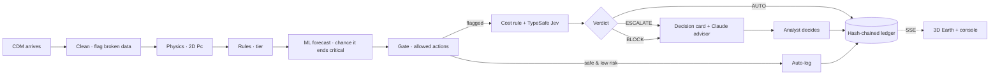

# ORBITAL DODGE 🛰️

**Satellite collision-avoidance triage, from the CDM flood to a signed-off decision.**

ORBITAL DODGE reads every conjunction warning (CDM) a satellite operator receives. Physics recomputes the collision probability, rules set the tier, ML forecasts which events will still be critical at the encounter, and **TypeSafe Jev** suggests an action. **Claude** explains it in plain English. The analyst signs off on a card that shows exactly why, and every step lands in a hash-chained ledger. All of it runs in a live 3D Earth simulator.

[](server/decisions/typesafe.py)
[](server/llm/explain.py)
[](ML.md)
[](ML.md)
[](game/)
[](server/tests/)

> **We beat the baseline.** Two days before closest approach, ORBITAL DODGE catches **94.8 %** of the encounters that end critical. The standard baseline catches **86.6 %**. Expected cost is **30 % lower**. Measured on the organizer's official labels, on missions the model never saw.
>
> Airbus track · Challenge 1 · Autonomous SG 2026 · built in one day, 31 Oct 2026

[Results](#we-beat-the-baseline) · [What the analyst sees](#what-happens-when-a-warning-turns-critical) · [Who decides](#who-decides-in-one-table) · [ML deep dive](ML.md) · [Full report](docs/REPORT.md) · [Judge guide](JUDGING.md)


---

## Project highlights

| Claim | Where to verify |
|---|---|
| **Beats the baseline on the official labels.** Critical events caught 2 days ahead: **93.7 % vs 85.1 %** (organizer 80/20 split, 5 seeds) and **94.8 % vs 86.6 %** (unseen missions). Expected cost −28 % / −30 %. AUC 0.988 vs 0.969 | `server/.venv/bin/python research/organizer/recompute_table.py` rebuilds the table in one command; [docs/REPORT.md §6](docs/REPORT.md#6-results-with-confidence-intervals) |
| **Physics you can check.** Our 2D collision probability, computed from the covariance, reproduces ESA's own values to a **median 0.06 on the log scale, with 98.97 % tier agreement**. It refuses to guess on broken data | [`server/riskengine/pc.py`](server/riskengine/pc.py), golden tests in [`server/tests/`](server/tests/) |
| **A model search that earned its winner.** **About 540 configurations** on our own 4-GPU server: a pre-registered bake-off of 8 models, 120 Optuna trials, a 403-config nested sweep, and 13 false-alarm experiments | [ML.md](ML.md), [docs/BAKEOFF.md](docs/BAKEOFF.md) |
| **A decision model that earns its place.** TypeSafe Jev returns a probability for each action, but only for actions the rules allow. Next to it, a cost rule gives a second opinion. After we fixed the policy, it handles **12 of 18** live decisions on its own, and the 6 it escalates are the right ones | [`server/decisions/`](server/decisions/), [docs/REPORT.md §6.6](docs/REPORT.md#66-fewer-hand-offs-to-the-analyst-live-typesafe-jev-ops-day-scenario) |
| **An LLM that only advises.** Claude writes a 2–3 sentence note. Every number in it is checked against the facts, and a fixed template is shown if the check fails | [`server/llm/verify.py`](server/llm/verify.py) |
| **Honest by construction.** Training events only ever show out-of-fold forecasts. Critical events are never automatic. Decision-model numbers are never shown as collision probabilities. Ties and losses are reported | [`server/tests/test_perf_honesty.py`](server/tests/test_perf_honesty.py), [docs/REPORT.md §7–8](docs/REPORT.md#7-trust-and-traceability) |
| **Today's real sky, screened by us.** 28,686 catalogued objects over 72 h on our GPU in about 2.5 min. Given the same orbit data, it finds 97 % of CelesTrak SOCRATES's events | [research/livesky/REPORT.md](research/livesky/REPORT.md) |
| **Full audit trail.** Every signal, decision and click is in a hash-chained ledger that you can verify from the UI | `GET /api/ledger/verify`, [`server/ledger/`](server/ledger/) |

---

## The problem

A satellite analyst gets **hundreds of collision warnings a week**, with an update every ~8 hours. Almost all are harmless and a few are real. For each one they must decide whether to **ignore it, get more tracking, or plan a dodge**, and the real decision has to be made about **one day before** the encounter. Today that's done by hand, with spreadsheets and threshold checks.

**Our goal:** turn the flood into a short, ranked to-do list, with a suggested action and its evidence, while the human still makes the call.

---

## We beat the baseline

The baseline is the standard rule: *whatever tier the event has two days out is its final tier.* It's harder to beat than it sounds; in ESA's Kelvins competition, only 12 of 97 teams beat its close cousin, the "latest risk" baseline.

| Organizer's official labels (11,942 events) | Baseline | **ORBITAL DODGE** |
|---|---|---|
| Critical caught 2 d ahead, organizer 80/20 split (5 seeds) | 85.1 % | **93.7 %** |
| Critical caught 2 d ahead, unseen missions | 86.6 % | **94.8 %** |
| Criticals still missed, unseen missions (of 834) | 112 | **43** |
| Expected cost per 1,000 events, unseen missions | 104.3 | **72.8** (−30 %) |
| AUC, unseen missions | 0.969 | **0.988** |

**The price:** more false alarms, on purpose. Precision drops from 85 % to 64 %. We decided a missed critical costs as much as **10 false alarms** (R = 10), derived from ESA and CARA cost evidence *before* we looked at scores ([docs/COST_RATIO.md](docs/COST_RATIO.md)).

---

## What happens when a warning turns critical

| | |
|---|---|
|  | **1. The warning lands.** `train:2563` looked safe two days out. Then, 10.5 h before closest approach, a new CDM puts the debris **136 m** away. Physics recomputes the Pc and the rules flag CRITICAL on miss distance. The inspector shows the **encounter plane** (the debris uncertainty cloud against our 3.55 m hard body) and the **risk evolution**, with a fan of 10,000 simulated futures. |
|  | **2. The system stops and asks.** Critical events always go to a human. The card shows one headline, three evidence tiles, **one recommendation** with how sure Jev is, the two strongest reasons, and Claude's short advisor note. The full audit trail is folded under *Details*. |
|  | **3. The analyst checks the geometry.** Relative position split into radial, along-track and cross-track, with ±1σ bands. Two days out the along-track uncertainty was ±22.7 km; now it's ±0.7 km. The warning has become trustworthy. |
|  | **4. The decision is recorded.** The analyst clicks, and the action, its reasons and every input are hash-chained into the ledger. `CHAIN ✓` verifies end to end. |
|  | **5. Anyone can audit the model.** ROC, precision–recall, reliability and expected cost against threshold, all computed out-of-fold, with the baseline marked. |
|  | **6. And it works on today's sky.** Real close approaches from our own screening of the current catalogue, validated against CelesTrak SOCRATES. |

---

## Who decides, in one table

| Who | Can do | Enforced where |
|---|---|---|
| **Physics** | Compute the collision probability, or refuse on broken covariance | [`riskengine/pc.py`](server/riskengine/pc.py) |
| **Rules** | Set the tier (worse of Pc and miss distance) and the allowed actions. A critical event can never be "keep monitoring" | [`riskengine/rules.py`](server/riskengine/rules.py), [`decisions/policy.py` `gate()`](server/decisions/policy.py) |
| **ML forecaster** | Add attention: rank the queue and raise a WATCH flag. It **never** lowers a tier or dismisses an alert | [`decisions/policy.py`](server/decisions/policy.py), [`test_perf_honesty.py`](server/tests/test_perf_honesty.py) |
| **TypeSafe Jev** (decision model) | Recommend one of the *allowed* actions, with a probability | [`decisions/typesafe.py`](server/decisions/typesafe.py) |
| **The system (code)** | Act alone only if the event isn't critical, Jev is **≥ 70 % sure**, and the cost rule agrees. Otherwise escalate, and block on broken data | [`decisions/policy.py` `verdict()`](server/decisions/policy.py), with reason strings shown to the analyst |
| **Claude** (LLM) | Explain in 2–3 plain sentences; every number is verified | [`llm/verify.py`](server/llm/verify.py) |
| **Analyst** | Approve or reject anything escalated; change the tier mode, threshold and confidence bar live on the Analyst desk | Approval card; `PUT /api/policy`, written to the ledger |

---

## Integrations

| System | Status | Proof |
|---|---|---|
| **TypeSafe Jev** (official API, `jev-1.14.0`) | **Live**: per-action probabilities in about 0.3 s | `train:2563`: *Prepare manoeuvre* at 0.92; ambiguous `train:2115`: split 44–53 %, so it escalates |
| **Claude** (`claude-sonnet-5-5`) | **Live**: advisor notes, checked for numbers and style | "The two objects are expected to pass 136 m apart in 11 hours… I'd have flight dynamics prepare manoeuvre options… It's your call." |
| **CelesTrak** (GP catalogue + SOCRATES) | **Live data**: 28,686 objects screened; ~19.5k shown on the globe | [research/livesky/REPORT.md](research/livesky/REPORT.md) |
| **Triologay** (our GPU server, over Tailscale) | **Used for**: the model search, risk futures, conformal calibration and sky screening | [ML.md](ML.md) |
| ESA Kelvins CDMs + organizer labels | The dataset; our labels match theirs on **13,154 / 13,154** events | [docs/REPORT.md §2](docs/REPORT.md#2-data-and-the-organizers-labels) |
| OpenRouter `jev-router` | Fallback decision provider (throttled, with vote shares) | [`decisions/jev.py`](server/decisions/jev.py) |

---

## Scenarios (each demonstrates one idea)

| Scenario | What you'll see |
|---|---|
| **Ops day, mission 15** | A 24 h duty shift with ~33 live conjunctions: the ranked queue, the 24 h danger window and approvals |
| **The late CDM** | Safe at the 2-day decision point, critical by miss distance 10.6 h before TCA. Nothing at T−2 d foresaw it |
| **Steady climb** | Pc climbs from 1e-9 to 2e-3 while the miss shrinks to 40 m: the full pipeline end to end |
| **Scary, then nothing** | The highest Pc in the training set collapses to nothing. Commit early, or wait? |
| **Rules disagree** | Critical by miss distance but safe by probability, next to the reverse case. Flip the tier mode and watch every marker recolour |
| **Covariance unknown** | Broken covariance: Pc refused, automation blocked |
| **Where we fail** | ESA's Pc we can't reproduce, and a critical event the forecaster missed |
| **Blind test** | Five unseen test events, truth hidden: forecasts only |
| **Free play** | A random cast, plus your own CDMs via `POST /api/assess` |


---

## How we chose the model


*Triologay did the heavy lifting: 56 cores, 2× V100 16 GB, a 32 GB PG503 and an RTX 2060.*

| Model (bake-off, same false-alarm budget, unseen missions) | Critical caught |
|---|---|
| 🥇 **LightGBM, all features** | **84.2 %** |
| 🥈 TabPFN | 83.8 % |
| GRU · risk futures (10k Monte Carlo paths) · EBM | 83.1 % |
| Baseline | 82.0 % |

*These are before cost-threshold optimisation.* We retrained the winner on the organizer's 11,942 events and set its alert threshold by cost, which gives the headline numbers. Extra features, ensembles and smarter thresholds could not cut false alarms beyond noise, and we report that as a tie. **The whole story is in [ML.md](ML.md).**

---

## Architecture



FastAPI backend (SSE + REST), three.js frontend, and SQLite for the ledger. Details are in [docs/REPORT.md §3](docs/REPORT.md#3-architecture-and-division-of-labour).

---

## Quick start

```bash
make setup        # Python venv + npm install
make precompute   # needs the organizer's CSVs in data/raw/ (not redistributed)
make test         # 168 backend tests
make dev          # backend :8000 + app http://localhost:5173
```

Pick **The late CDM** and hit **8×**. Keys go in a gitignored `.env` (`C1_TYPESAFE_API_KEY`, `C1_ANTHROPIC_API_KEY`; see `.env.example`). With no keys, everything runs in a clearly labelled mock mode.

---

## Where it fails, and how the analyst knows

- **Late escalations still happen.** 43 of 834 criticals are missed 2 days ahead (the baseline misses 112). `train:2563` is one: physics catches it on the late warning, and the card shows the low forecast.
- **About 1 alert in 3 is false.** Precision is 64 % vs 85 % for the baseline. That's the price of catching more.
- **ESA's Pc can't always be reproduced** (`train:4200`). The disagreement is flagged on the card, and the higher value wins.
- **Not yet proven:** that it beats an expert analyst. Jev hasn't been validated offline.

**More:** [ML.md](ML.md) (the model story) · [docs/REPORT.md](docs/REPORT.md) (every number with its source) · [JUDGING.md](JUDGING.md) (5-minute judge path)
