# ORBITAL DODGE

**Collision-avoidance triage for the duty conjunction analyst of a LEO satellite.**
Airbus problem statement, Challenge 1 ("AI-driven satellite collision avoidance"), Autonomous SG 2026, AI & Aerospace track, 31 October 2026.

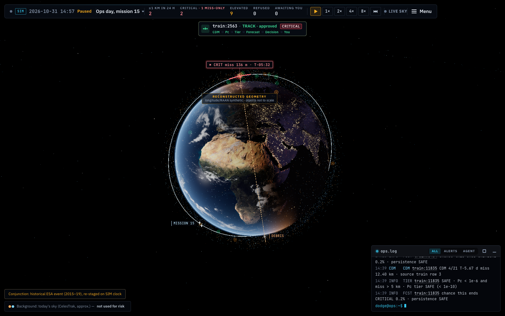
*Ops day, mission 15, paused at SIM 14:57. The globe shows today's catalogue as background. The focal event `train:2563` is CRITICAL with a 136 m miss. The HUD counts 2 events within 1 km in the next 24 h, 2 CRITICAL (1 of them on miss distance only) and 9 ELEVATED. The strip at the top traces the pipeline for the event: CDM → Pc → Tier → Forecast → Decision → You. `ops.log` sits bottom centre.*

---

## TL;DR

**User and system.** Our user is the **duty conjunction analyst** at a LEO Earth-observation operator, modelled on the ESA Space Debris Office whose 2015–2019 CDM archive is the challenge dataset. A new batch of conjunction data messages (CDMs) reaches the analyst about every 8 hours. ORBITAL DODGE handles each one in fixed steps:
1. **Physics** recomputes the collision probability (Pc) from the full covariance. It refuses when the covariance is a default value.
2. **Rules** apply the brief's CARA/ESA tiers and decide which actions are allowed.
3. **A forecaster** estimates, two days before closest approach, whether the event will still be CRITICAL at the end. It can only add attention.
4. **A decision model** (TypeSafe Jev) picks among the allowed actions. An LLM explains the result, and every number it writes is checked.
5. **A human approves.** Every step is written to a hash-chained ledger and shown in a 3D simulator.

**We beat the baseline.** The baseline is the standard rule "the tier at ≥ 2 days before the encounter is the final tier". We measured on the **organizer's official labels**, 11,942 usable events:

| | Baseline | ORBITAL DODGE |
|---|---|---|
| Critical events caught, organizer 80/20 split (5 seeds) | 85.1 % | **93.7 %** |
| Critical events caught, held-out missions | 86.6 % | **94.8 %** |
| Expected cost per 1,000 events, 80/20 | 110.8 | **80.1** (−28 %) |
| Expected cost per 1,000 events, held-out missions | 104.3 | **72.8** (−30 %) |
| AUC, 80/20 (held-out missions: 0.969 vs 0.988) | 0.970 | **0.988** |

You can recompute the held-out-missions rows without retraining: `server/.venv/bin/python research/organizer/recompute_table.py` reads the committed out-of-fold file and prints 722 vs 791 caught, 126 vs 439 false alarms and 104.3 vs 72.8 cost per 1,000 events (§11.4).

**What it costs.** We raise more false alarms, on purpose: 89.4 against 24.8 per 80/20 test set. The trade is set by a cost ratio R = 10, meaning one missed critical counts as much as ten false alarms. R was derived from ESA, NASA OTPS and CARA cost evidence and fixed before we read any model scores, as [docs/COST_RATIO.md](docs/COST_RATIO.md) records (§1 says what that record can and cannot prove). Macro-F1 over the three tiers is a tie (0.895 vs 0.895).

**Where it fails, and how the analyst would know** (all of [§8](#8-where-it-fails-and-how-the-analyst-knows)):
- **43 of 834 criticals are still missed 2 days ahead** (held-out missions). Baseline misses 112.
- **`train:2563` (scenario *The late CDM*):** the forecast at T−2 d is 1.1 %, and the event ends CRITICAL at a 136 m miss. Physics and rules catch it on the late CDM, and the event opens an approval card that shows the low forecast, so the analyst sees the forecaster missed it.
- **About 1 alert in 3 is false:** precision of a CRITICAL alert is 64 % (held-out missions), against 85 % for the baseline.
- We have not shown that it is safer than an expert, and the decision model (Jev) has not been validated offline.

---

## Contents

0. [Rubric → evidence](#0-rubric--evidence)
1. [The user and the problem](#1-the-user-and-the-problem)
2. [Data and the organizer's labels](#2-data-and-the-organizers-labels)
3. [Architecture and division of labour](#3-architecture-and-division-of-labour)
4. [Physics: Pc from the covariance](#4-physics-pc-from-the-covariance)
5. [Machine learning: the full process](#5-machine-learning-the-full-process)
6. [Results (with confidence intervals)](#6-results-with-confidence-intervals)
7. [Trust and traceability](#7-trust-and-traceability)
8. [Where it fails, and how the analyst knows](#8-where-it-fails-and-how-the-analyst-knows)
9. [The 3D simulator and the analyst's screens](#9-the-3d-simulator-and-the-analysts-screens)
10. [Live sky: our own screening of today's catalogue](#10-live-sky-our-own-screening-of-todays-catalogue)
11. [How we tested it locally](#11-how-we-tested-it-locally)
12. [Impact: before and after for the analyst](#12-impact-before-and-after-for-the-analyst)
13. [Time discipline](#13-time-discipline)
14. [Repository map](#14-repository-map)
15. [Limits and next steps](#15-limits-and-next-steps)
16. [Credits and data](#16-credits-and-data)

**Provenance rule for this README:** every number is traceable. The index is [`docs/FACTS.json`](docs/FACTS.json), which gives each value with the file and key it comes from. Where we derived a number by arithmetic (for example a percentage), we say so and show the inputs.

---

## 0. Rubric → evidence

| Criterion (weight) | What we claim | Evidence (numbers) | Where to verify |
|---|---|---|---|
| **Problem realism (20)** | A named user (duty conjunction analyst, ESA-SDO-style LEO operator), a narrow workflow (triage every ~8 h CDM drop; go/no-go at the manoeuvre commitment point 0.5–1 d before TCA) and a stated status quo | ESA: "hundreds of alerts" per satellite per week, ~2 need follow-up with "hours of analysis". CARA: a ×8–9 rise in manoeuvres would be "unbearable". Cost ratio R = 10 derived from evidence (central 6.0, MC P90 10.3) | [§1](#1-the-user-and-the-problem), [docs/design/12-domain-research.md](docs/design/12-domain-research.md) §1.4–1.7, §5, [docs/COST_RATIO.md](docs/COST_RATIO.md) |
| **Technical soundness (25)** | Each layer does one job. Physics computes Pc, rules compute tiers and allowed actions, statistics forecast, the decision model picks only among rule-allowed actions, and the LLM only explains (every numeral is verified). Runs end to end, including ad-hoc CDM input (`POST /api/assess`) | Pc reproduces the dataset `risk`: median error 0.059 dex, 98.97 % tier agreement, Pc ≥ 1e-4 recall 0.918 / precision 0.945. **168/168 backend tests pass.** 28 REST/SSE endpoints. Headless end-to-end runs (mock mode): 1,805 SSE events, 48 verdicts, 0 HTTP errors, ledger verify OK over 729 entries ([§11.3](#113-end-to-end-runs-against-a-real-backend-headless)) | [§3](#3-architecture-and-division-of-labour), [§4](#4-physics-pc-from-the-covariance), [`server/riskengine/`](server/riskengine/), [`server/decisions/policy.py`](server/decisions/policy.py), [`server/llm/verify.py`](server/llm/verify.py) |
| **Honest evaluation (20)** | The baseline is stated: the tier of the latest message ≥ 2 d out is kept as the final tier. We use the organizer's labels, two splits (80/20 by event, held-out missions) and bootstrap CIs. The bake-off rule was written down before scoring and sha256-pinned (the order is our attestation, see §5.3). Leakage audits were run. Negative results are reported. The headline table can be recomputed from a committed file in one command | **Beats baseline:** recall 93.7 % vs 85.1 % (80/20), 94.8 % vs 86.6 % (missions). Cost −28 % / −30 %. Macro-F1 is a tie, and the baseline wins the ≥ 2 d slice by construction. The false-alarm study ended in a tie | [§5](#5-machine-learning-the-full-process), [§6](#6-results-with-confidence-intervals), [`research/organizer/results.json`](research/organizer/results.json), [docs/BAKEOFF.md](docs/BAKEOFF.md), [`research/bakeoff/audit/`](research/bakeoff/audit/) |
| **Trust & traceability (20)** | Every tier names the rule that fired and its citation. Pc is refused on a default covariance. Forecasts for training events are always out-of-fold. Decision-model probabilities are labelled as such. Every LLM numeral is verified. Ledger is hash-chained and append-only. A human approves | CRITICAL is never AUTO. PREPARE is never automatic. In-sample forecast for `train:2563` would be 0.88; we serve the out-of-fold 0.011. Ledger verify shows `CHAIN ✓ 1,408 ENTRIES` in the demo | [§7](#7-trust-and-traceability), [`server/tests/test_perf_honesty.py`](server/tests/test_perf_honesty.py), [`server/ledger/ledger.py`](server/ledger/ledger.py), `GET /api/ledger/verify` |
| **Where it fails** | Seven named failure cases, each with an event key, the numbers, and how the analyst sees it | Late escalation `train:2563` (forecast 1.1 %, then CRITICAL at 136 m). `train:4973` missed by all 8 bake-off models. Pc-driven criticals are 6 of 551. Default covariance (`train:2299`). Physics vs ESA disagreement (`train:4200`) | [§8](#8-where-it-fails-and-how-the-analyst-knows), scenarios "The late CDM", "Rules disagree", "Covariance unknown", "Where we fail" |
| **Impact (10)** | Measured on held-out missions: more criticals caught 2 days ahead at a lower expected cost. The price in false alarms is stated | 791 vs 722 of 834 criticals caught. Missed per 1,000 events: 3.6 vs 9.4. False alarms per 1,000: 36.8 vs 10.6. Model wins for any R above ~4.5 | [§12](#12-impact-before-and-after-for-the-analyst) |
| **Time discipline (5)** | Built and committed in one day, with a 3-minute demo script | 12 commits before this README, 11:37 → 14:21 on 2026-10-31; the submission time is the final commit on the pushed branch | [§13](#13-time-discipline) |

A 5-minute hands-on path for judges is in [JUDGING.md](JUDGING.md). **This README is long on purpose, for traceability. The TL;DR plus this table is the 2-minute read.**

---

## 1. The user and the problem

### Who the user is
The **duty conjunction analyst** for one LEO Earth-observation satellite, working in an operator's flight-dynamics or space-debris office. Our model of this office is the ESA Space Debris Office, which supports Sentinel, CryoSat and Swarm. That choice is forced by the data: the challenge dataset is that office's 2015–2019 CDM archive (19 missions in the training file). Our demo operator is **mission 15**. Source: [docs/design/40-final-design.md §1](docs/design/40-final-design.md), [docs/design/12-domain-research.md §5.1](docs/design/12-domain-research.md).

### What they do today (status quo)
| Step | Today | Source |
|---|---|---|
| Input | A CDM batch from 18/19 SDS screening about every 8 h. In our data the median gap between CDMs is 8.07 h and 74.4 % of gaps are 6–10 h. There are about 13 CDMs per event, and the first arrives a median 6.6 d before TCA | [doc 11 §D](docs/design/11-dataset-experiments.md); CARA Vol 2 App. Q.1 |
| Volume | "Hundreds of alerts" per satellite per week. About 2 per satellite per week need detailed follow-up, and each takes "hours of analysis". More than one collision-avoidance manoeuvre (CAM) per satellite per year | ESA, *Automating collision avoidance*; [doc 12 §1.5](docs/design/12-domain-research.md) |
| Tools | Per-CDM threshold checks on the reported Pc and miss distance, in in-house tools or the CARA MATLAB SDK, plus spreadsheets and e-mail. Each CDM gives one number, with no forecast and no record of which rule fired | [doc 40 §1](docs/design/40-final-design.md), [doc 12 §5.1](docs/design/12-domain-research.md) |
| Decision point | Go/no-go at the **manoeuvre commitment point (MCP), 0.5–1 d before TCA**. ESA alerts teams about 3 d before TCA and decides about 1 d before | CARA Vol 2 App. F; [doc 12 §0, §1.3](docs/design/12-domain-research.md) |
| Real incident | Swarm-B: alert ~39 h out, commands uplinked ~15 h out, manoeuvre aborted at the final go/no-go, with only two ground-contact slots | ESA, *Anatomy of a debris incident* |

### Why it hurts (cost of each error)
- **A false alarm costs real effort.** It means analyst hours, possibly a tracking request or manoeuvre planning, and in rare cases an unnecessary burn with an instrument outage. CARA says that switching to more conservative metrics would multiply manoeuvres ×8–9, which it calls "unbearable" (Vol 2 App. M.5).
- **A missed CRITICAL at T−2 d is late discovery, not a collision.** The operator's own screening still sees it inside the last 2 days. The cost is a rushed response: compressed analysis, about 2× the Δv (CARA App. Q.8) and an outage that cannot be scheduled. There is also a small chance that the late response cannot be finished in time.
- **Hidden data hazards.** 3.2 % of training CDM rows (5,129 train rows, 1,313 train events; doc 11) carry a **default covariance** (σ = 63,781,363 m, ten Earth radii). The `risk` reported on those rows is meaningless (≈ −14.3). A status-quo tool still shows it as a number ([doc 11 §C.1](docs/design/11-dataset-experiments.md)). Counting the test set too, our pipeline flags 5,831 rows (train + test) as `COV_UNKNOWN` (§2, §4).

### The cost ratio we use (R = 10), and how we derived it
[docs/COST_RATIO.md](docs/COST_RATIO.md) (status "predetermined") records that it was written before any sweep result was produced or read: only the label file was opened, no model output, OOF file or score. **This is our own statement, not something git can prove.** Unlike `PREREG.md`, the file is not hash-pinned. It was first committed at 14:02 (`1ddfa4e`), after the v1 tier-forecaster metrics (12:21, `e9d9449`) and the organizer results that already use R = 10 (13:16, `2044eb8`).
- **Cost model.** C_fa (review hours, tracking, planning, unnecessary CAMs with outage) and C_miss (rush hours × overtime, late-CAM extra cost, residual collision risk). Inputs come from NASA OTPS 2023 labour, outage and loss values, ESA alert volumes, the Swarm-B timeline, and CARA's 2× late Δv.
- **Result.** Central C_fa ≈ €1,120 and C_miss ≈ €6,750, so **R = 6.0**. A 200,000-draw Monte Carlo gives R P10 / P50 / P90 = **2.4 / 5.1 / 10.3**.
- **Choice: R = 10**, which is about P90. The user's priority is to catch criticals. R ≥ 20 is not supported: at R ≥ 14, "flag every event" already beats "flag none" on this label.
- **Alert rule:** the cost-optimal threshold `10·FN + FP` with a recall floor of 90 % and a target of 95 % (§5.7).

---

## 2. Data and the organizer's labels

### Dataset facts
| Item | Value | Source |
|---|---|---|
| Training CDMs / events / missions | **162,634 / 13,154 / 19** | `data/processed/cdm_clean.parquet`, `events.parquet` |
| Test CDMs / events / missions | **24,484 / 2,167 / 18** | same |
| Final tiers (all train events) S / E / C | 9,843 / 2,403 / 908 | `data/raw/organizer/train_event_labels.csv` |
| **Organizer "usable for training"** | **11,942 events**: tiers 8,946 / 2,162 / **834 critical** (1,212 not usable) | organizer label file; `research/organizer/out/build_summary.json` |
| Tier rule (organizer `tier_rules.csv`) | Critical: risk ≥ −4 **or** miss < 1,000 m. Elevated: −6 ≤ risk < −4 **or** 1–5 km. Safe otherwise. Precedence C > E > S | `data/raw/organizer/tier_rules.csv` |
| `risk = −30` | A placeholder for "too small to compute". 67,240 train rows sit at this floor | `tier_rules.csv` note |
| Default-covariance rows | 5,129 train rows (doc 11 §C.1). In our pipeline, 5,831 rows (train + test, 187,118 rows in all) get Pc status `COV_UNKNOWN` | `data/processed/pc_rows.parquet` |

**Our labels match the organizer's exactly.** We recomputed the final tier of every training event from the raw CDMs. It agrees with the organizer's `final_tier` on **13,154 of 13,154 events** (`build_summary.json`: `label_mismatches_vs_organizer = 0`).

### The forecasting question (Kelvins-style)
Manoeuvres are planned at least 2 days before TCA (Uriot et al. 2022 §4.2), and the test set's inputs stop at `time_to_tca ≥ 2 d`. So the product question is: **"Using only CDMs at T−2 d or earlier, will this event's final tier be CRITICAL?"**

The organizer population splits by the time of the final CDM ([`model_card.json`](registry/forecaster_organizer/1.0.0/model_card.json) caveats):

| Sub-population | Events | Critical | Comment |
|---|---|---|---|
| final CDM < 1 d before TCA (`final_lt1d`) | 8,293 | 551 | Identical to the Kelvins-eligible set. This is where the forecasting problem lives |
| final 1–2 d (`final_1to2d`) | 599 | 39 | Small, hard |
| final ≥ 2 d (`final_ge2d`) | 3,050 | 244 | **The final CDM is the latest input**, so the baseline is exact by construction (recall 1, 0 false alarms). We report this slice separately so it cannot inflate or dilute claims |

### The 13-column question
The brief lists 13 columns that can be used "for simplicity purposes". We tested what those 13 columns can and cannot do, and we explain each extra column we use:
- **Physics needs the full covariance.** With only the radial sigmas in the 13 columns, an isotropic 2D Pc reaches Spearman **0.34** against `risk`, against **0.94** with the full covariance. A gradient-boosted model on the 13 columns has a 3.7 dex error. The reason is that the dominant uncertainty is along-track (`c_sigma_t` median ~4 km, `c_sigma_r` median 68 m) ([doc 11 headline 2, §C.4](docs/design/11-dataset-experiments.md)). So the Pc layer reads the covariance columns and says so in the UI and the ledger.
- **The forecaster beats the baseline even with only the 13 columns.** The same LightGBM trained on 84 features built **only from the 13 brief columns** ("A13") gets:
  - 80/20 split: recall **93.4 %**, 78.4 false alarms, cost 77.2.
  - Held-out missions: recall **94.6 %**, 435 false alarms, cost 74.1 ([`research/organizer/results.json`](research/organizer/results.json)).

  The served model uses all 233 features ("ALL") because it won the pre-registered bake-off (§5.3). The two are within each other's CIs. A13 is a drop-in alternative for anyone who reads the brief strictly.

---

## 3. Architecture and division of labour

**Ground rule, enforced in code and tests:** each layer does exactly one job, and no layer can override a layer above it in this list.

| # | Layer | Its one job | What it may **not** do | Code |
|---|---|---|---|---|
| 1 | **Physics** | 2D Pc per CDM from the full covariance | Guess when the covariance is a default: it returns `COV_UNKNOWN` instead | [`server/riskengine/pc.py`](server/riskengine/pc.py) |
| 2 | **Rules** | Tier = max(Pc tier, miss tier) in BRIEF mode; data-quality gates; the allowed actions per tier | — (rules are the compliance layer) | [`server/riskengine/rules.py`](server/riskengine/rules.py), [`server/decisions/policy.py`](server/decisions/policy.py) |
| 3 | **ML forecast** | P(final tier = CRITICAL) at T−2 d | Lower a tier or suppress an alert. It can only **add** a WATCH | [`server/riskengine/forecast.py`](server/riskengine/forecast.py), [`registry/forecaster_organizer/`](registry/forecaster_organizer/) |
| 4 | **Decision model** (TypeSafe **Jev**, official System One API) | Pick one action among the rule-allowed actions, with a probability per action. Shown next to an **expected-cost rule** baseline | Choose an action the rules do not allow, or skip the human on CRITICAL or PREPARE | [`server/decisions/typesafe.py`](server/decisions/typesafe.py), [`expected_cost.py`](server/decisions/expected_cost.py) |
| 5 | **Policy verdict** (code) | AUTO / ESCALATE / BLOCK, with verbatim reason strings | — | [`server/decisions/policy.py`](server/decisions/policy.py) |
| 6 | **LLM** (Claude `claude-sonnet-5-5`) | Explain, using `{{placeholders}}` filled from a fact sheet. A verifier rejects any numeral that is not a fact value | Compute Pc, a tier, legality, or recommend an action that contradicts the verdict | [`server/llm/`](server/llm/), [`verify.py`](server/llm/verify.py) |
| 7 | **Human** | Approve, reject, or choose another allowed action, with a note | — | approval card, `POST /api/approvals/{id}` |
| 8 | **Ledger** | Append-only, hash-chained record of every signal, decision, explanation and approval | Be edited: SQLite `BEFORE UPDATE/DELETE` triggers abort | [`server/ledger/ledger.py`](server/ledger/ledger.py) |

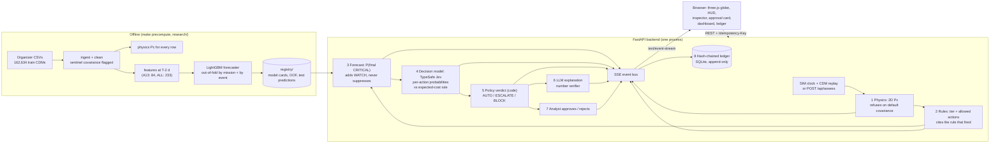

**Verdict logic** ([`policy.py`](server/decisions/policy.py), `verdict()`):
- **BLOCK** whenever the covariance is a default. "Covariance is a default: not actionable (CARA App. P.7)". PREPARE is then not offered.
- **ESCALATE** if any of these holds, and every applicable reason is listed:
  - the rules require a human (CRITICAL or a data-quality flag);
  - the decision model is less than 70 % sure of its own pick (the probability it gives the chosen action; default bar 70 %);
  - the model disagrees with the cost rule;
  - the model says the evidence is thin;
  - the action is PREPARE.
- **AUTO** only for low-stakes actions that pass all of the above. AUTO decisions are logged, not hidden.
- **Defence in depth:** "CRITICAL events always come to you".

**Runtime:** the SIM clock runs at 4 Hz, where 1× is 3 sim-minutes per second, with 2×/4×/8× available. The clock **holds** while an approval is pending (for at most 45 real seconds). Decision-provider chain, with a 12 s budget: `typesafe-jev` (official) → `openai-decisions` → `jev-router` (OpenRouter, k = 5 vote shares) → `mock`. Each fallback is labelled in the UI ([`server/decisions/provider.py`](server/decisions/provider.py)).

---

## 4. Physics: Pc from the covariance

**What:** the standard 2D (short-encounter) probability of collision ([`pc.py`](server/riskengine/pc.py), method `2D-Foster-GL24x48`), in four steps:
1. Build the RTN covariance of each object.
2. Rotate the chaser covariance into the target RTN frame and sum the two covariances.
3. Project onto the encounter plane, perpendicular to the relative velocity.
4. Integrate the bivariate normal over a disc of radius **HBR = (t_span + c_span)/2**, using 24 × 48 Gauss–Legendre points in log-space, so log10 Pc stays exact well below 1e-300.

The module also reports the principal sigmas, the Mahalanobis distance, the dilution factor k* and Pc_max.

**Why HBR = (t_span + c_span)/2:** it is the dataset's own convention. It has bias −0.000 dex against `risk` with no fitting ([doc 11 §C.3](docs/design/11-dataset-experiments.md)).

**Validation against the dataset's `risk` column (ESA's value):**

| Check | Result | Source |
|---|---|---|
| Median absolute error, all clean rows (157,468), no fitting | **0.059 dex** | doc 11 headline 1 |
| Median absolute error, pipeline recheck on rows with risk ≥ −10 (45,737 rows) | **0.0545 dex** | `pc_rows.parquet` vs `cdm_clean.parquet` (recomputed) |
| Median absolute error, risk ≥ −4 (the band that matters) | 0.006 dex (doc 11); 0.0026 dex (pipeline, 715 rows) | doc 11 §C.3; recomputed |
| Brief-tier agreement per row | **98.97 %** (157,346 rows). No safe↔critical swaps | doc 11 §C.3; recomputed 98.968 % |
| Pc ≥ 1e-4 as a detector of risk ≥ −4 | recall **0.918**, precision **0.945** | doc 11 §C.3 |
| Effect of the frame rotation | error 5.99 → 1.18 dex | doc 11 §C.3 |

**Where physics and ESA disagree:**
- Far encounters dominated by Gaussian tails: miss > 20 km has an error of 2.5 dex, against 0.065 dex for miss ≤ 5 km.
- **Missions 6 and 7**, which hold 28.5 % of the bad rows but only 10.7 % of all rows.

We cannot reproduce ESA's covariance scaling there, so a rule (`Q-PHYS-DISAGREE`) takes the **higher** of the two values and escalates (§8).

**Pc status codes per row (train + test, 187,118 rows):**

| Status | Rows |
|---|---|
| OK | 181,134 |
| COV_UNKNOWN (refused) | 5,831 |
| LOW_VREL (2D assumption invalid, escalate) | 151 |
| NPD_CLIPPED | 2 |

---

## 5. Machine learning: the full process

### 5.1 The baseline we had to beat
**The baseline:** the tier of the latest CDM at T−2 d or earlier is the predicted final tier. It is hard to beat:
- It is exact for 92.9 % of Kelvins-eligible events ([doc 11 headline 3](docs/design/11-dataset-experiments.md)).
- In the original Kelvins competition, only 12 of 97 teams beat the related latest-risk baseline (Uriot et al. 2022; [doc 12 §0](docs/design/12-domain-research.md)).

We report baseline next to every model number.

### 5.2 Target and splits
- **Target:** the final tier, with an alert when P(CRITICAL) is at or above a threshold. Inputs are only CDMs with `time_to_tca ≥ 2 d`. `mission_id` is never a feature.
- **Splits:**
  - **(a) organizer 80/20 by event:** `GroupShuffleSplit`, 5 seeds, about 2,389 test events per seed.
  - **(b) held-out missions:** `GroupKFold(5)` over the 19 missions, so every prediction comes from a model that never saw that satellite.
- **Statistics:** bootstrap CIs with B = 500 (organizer evaluation) or B = 1,000 (bake-off, paired across models).

### 5.3 Pre-registered bake-off (8 contenders)
We wrote the decision rule in [`research/bakeoff/PREREG.md`](research/bakeoff/PREREG.md) and pinned it with sha256 ([`PREREG.sha256`](research/bakeoff/PREREG.sha256)). It has no amendments.

**What this does and does not prove.** `PREREG.md` is dated 31 Oct 2026 in its text and says it was written before any contender result was scored. It was first committed together with the results in `1ddfa4e` (14:02). The hash proves the file has not changed since that commit. **It does not prove that the file was written before scoring; that order is our attestation, not something git can show.** The only timestamps we have are local file times on the dev machine, which are weaker evidence: `PREREG.md` 12:05:43 and `PREREG.sha256` 12:05:44, then the contender result files (`research/bakeoff/results/gru.json` 12:18, `tabpfn.json` 12:22, `ebm.json` 12:26), the scoring log `research/bakeoff/logs/score_all.log` 12:34 and `leaderboard.json` 12:37. The one earlier log, `logs/refs.log` (12:04), holds only the reference models' early-stopping iteration counts, no scores.
- **PRIMARY metric:** critical recall at the baseline's own false-alarm budget (113), computed by held-out mission.
- **Winner:** the highest PRIMARY. It is served only if one of these holds:
  - (a) the paired ΔPRIMARY CI lower bound is above 0, or
  - (b) PRIMARY ≥ baseline − 0.01 **and** the AUC CI lower bound is above the baseline's AUC.
- **Contenders:**
  - entrants: risk-futures MDN, TabPFN v2, EBM and GRU;
  - references: baseline, HGB-A13, LightGBM-A13 and LightGBM-ALL.
- **Population:** the Kelvins-eligible 8,293 events, 551 critical.

The leaderboard is in §6.4. **lgbm_all won through gate (b).** Its paired gain CI touches zero, [+0.000, +0.041]. TabPFN was 2 events behind and is the only contender with a significant gain (gate a).

**The honest reading:**
- Every ML model clearly beats the baseline on **ranking** (AUC 0.98 vs 0.96).
- At the baseline's own false-alarm budget, the gain is small: +12 of 551 criticals.
- Audit seeds give PRIMARY 0.828–0.842 ([docs/BAKEOFF.md](docs/BAKEOFF.md)).

### 5.4 The big compute run on our own GPU server, Triologay

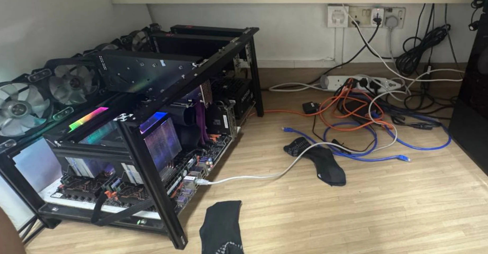
*Triologay is our own open-frame GPU server: 56 CPU cores and 4 GPUs, among them a Tesla V100-SXM2 16 GB, a Tesla PG503-216 32 GB and a GeForce RTX 2060. The GPU names come from the TabPFN run logs and the live-sky report, and the core and GPU counts from the bake-off model card. We reached it from the MacBook over Tailscale. Every heavy job below ran on it; the laptop, a MacBook M2 with 8 GB, ran the app, the tests and the end-to-end runs.*

What ran on Triologay, and why each job was needed:

| Job | What exactly | Why | Output |
|---|---|---|---|
| Hyper-parameter sweep | **315 configurations**: 164 CPU GBM, 17 GPU GBM, 61 neural, 72 other tabular, 1 reference; **17 model classes**. Nested by-mission cross-validation, with the inner folds choosing the threshold | Find out whether any family beats LightGBM at R = 10 without overfitting the outer test | [`research/fa/ens/config_rank.csv`](research/fa/ens/config_rank.csv) |
| Optuna | 60 trials each for A13 and ALL, tuned on a separate by-event split (seed 99). LightGBM averaged over 10 seeds | Tuned parameters that are not chosen on the reported folds | [`research/bigml/run_gbm.py`](research/bigml/run_gbm.py), [`results.json`](research/bigml/results.json) |
| Risk futures | A mixture-density network (10 components, 3 × 256 MLP) that learns CDM → next-CDM transitions from 31 state features, then **10,000 Monte Carlo paths per event** to TCA on the GPU (4,000 for by-event and leave-one-mission-out runs) | A full distribution of how the event can still evolve; the fan charts in the inspector | [`research/bigml/REPORT.md` §A](research/bigml/REPORT.md), `registry/futures/` |
| Conformal calibration | Split conformal on futures P(critical), calibrated only on **other missions** | An alert threshold with a stated recall target | [REPORT §B](research/bigml/REPORT.md), [`registry/conformal/`](registry/conformal/) |
| Decision policy | Value iteration (backward induction) over 588 discretised CDM states, using real and MDN-simulated transitions | Whether "request tracking" or "prepare" is worth it at each state, under stated costs | [REPORT §C](research/bigml/REPORT.md), [`registry/policy/`](registry/policy/) |
| TabPFN | By-event OOF in 611 s on the V100, by-mission in 727 s on the RTX 2060, final fit in 3 min 44 s on the PG503 | A foundation-model contender in the bake-off | [`research/bakeoff/models/tabpfn/NOTES.md`](research/bakeoff/models/tabpfn/NOTES.md) |
| Live-sky screening | 28,686 objects × 72 h at 10 s steps. SGP4 on 52 processes takes 21.5 s; the GPU spatial hash on the PG503 takes 21.6 s and peaks at 3.43 GB; 156 s in total | Our own screening of today's catalogue (§10) | [`research/livesky/REPORT.md`](research/livesky/REPORT.md) |

### 5.5 Aligning with the organizer's labels
The bake-off used the Kelvins-eligible population. When the organizer published its official label set, we **re-ran the evaluation on its population**: 11,942 usable events, 834 critical ([`research/organizer/`](research/organizer/), commit `2044eb8`).
- **Label check:** we confirmed 13,154/13,154 agreement.
- **Training:** we retrained on the organizer population.
- **Splits:** we evaluated on both splits and broke the results down by the three sub-populations.
- **Threshold:** chosen on OOF predictions **inside the training data** as argmin `10·FN + FP` subject to recall ≥ 0.90. For the final model, trained on all 11,942 events, the inner recall was 95.4 % and the threshold is p_critical ≥ 0.0634.
- **Held-out results use each fold's own threshold.** Every held-out-mission number in this README (791 caught, 439 false alarms, cost 72.8) uses the threshold that fold chose inside its own training missions: 0.050 for the fold that holds mission 15, 0.079–0.103 for the others (`thr_mission` in `oof_organizer.parquet`). If you apply 0.0634 to all OOF scores instead, you get 796 caught, 511 false alarms, cost 74.6 per 1,000. That is also below the baseline's 104.3, but it is not what we report.
- **Serving:** the served model is `registry/forecaster_organizer/1.0.0` (`CURRENT`).

**Every threshold in the system, and what it triggers:**

| Threshold | Value | Where it is set | What it triggers |
|---|---|---|---|
| CRITICAL alert, final model | p_critical ≥ **0.0634** | `registry/forecaster_organizer/1.0.0/model_card.json` | The CRITICAL alert on the 2,167 test events (`alert_critical` in `registry/forecaster_organizer/1.0.0/predictions_test.parquet`) |
| CRITICAL alert, per fold | **0.050–0.103** (0.050 for mission 15's fold) | `thr_mission` in the OOF file | The alert for training events. The approval card shows it as "alert threshold t = 0.050 … below t". Used for every held-out number in §6 |
| WATCH (in the running app) | follows the served model's own alert flag: p_critical ≥ **0.0634** (the desk τ defaults to it and can override) | `policy.watch_flag`; `Sim.default_policy()` reads the threshold from the model card | Turns a SAFE event into "SAFE on watch". This allows Request tracking and sends the event to the decision model, so the app runs at the evaluated operating point (held-out missions: 94.8 % of criticals caught at the per-fold cut-off). For comparison, τ = 0.20 gives 90.9 % with 214 false alarms (cost 81.6 per 1,000; `recompute_table.py`) |
| Decision-model confidence bar | **70 %** (editable, 50–99 %) on the probability Jev gives its chosen action | `policy.py` `confidence_bar` | Below the bar, the verdict is ESCALATE ("Decision model only 56 % sure of TRACK (bar 70 %)"). TypeSafe's separate `confidence` field is kept as `model_confidence` in Details and never gates |
| Brief tiers | Pc ≥ 1e-4 or miss < 1 km = CRITICAL; Pc ≥ 1e-6 or miss < 5 km = ELEVATED | `rules.py` | The tier, which the forecaster cannot lower |

The app's WATCH follows the served model's alert flag, so the running system acts at the same operating point that §6 evaluates. An operator who prefers fewer alerts moves τ on the desk (e.g. 0.20 → 90.9 % recall, 214 false alarms on held-out missions), and the change is written to the ledger.

### 5.6 The false-alarm reduction study (an honest tie)
We tried to cut false alarms without losing recall. There were **13 new candidates**:
- physics features from our Pc;
- futures features;
- ensembles (mean, rank, RF / HGB members);
- bagging;
- Mondrian and two-signal thresholds;
- three baseline variants.

The selection rule was fixed in advance: the lowest by-mission cost at R = 10 with recall ≥ 0.90. If the paired cost-difference CI includes 0, the candidate is preferred only if it also has fewer false alarms and recall within 0.01.

- **The rule's winner** is `lgbm_all_phys` (1.1.0). Against the served 1.0.0, by mission: Δcost −1.8 [−7.0, +3.0], ΔFA −1 [−19, +16].
- **On 80/20,** it cut false alarms (ΔFA −8.8 [−12.8, −5.1]), but the cost CI includes 0.
- **At matched recall,** it was not better (82.6 vs 81.0; 442 vs 423).

**Verdict: tie.** We kept 1.0.0 as the served model and stored 1.1.0 as an alternative. Selection on the same data biases this toward optimism, so a tie is the honest reading. Sources: [`research/fa/select/results.json`](research/fa/select/results.json), [`registry/forecaster_organizer/1.1.0/model_card.json`](registry/forecaster_organizer/1.1.0/model_card.json).

### 5.7 The operating curve, and why we chose about 95 % recall
These operating points are recomputed from the held-out-mission OOF predictions ([`oof_organizer.parquet`](registry/forecaster_organizer/1.0.0/oof_organizer.parquet)), with 834 critical events in total:

| Recall | Criticals caught | False alarms | Extra false alarms per extra critical caught (vs previous row) |
|---|---|---|---|
| **86.6 % (the baseline's recall)** | 722 | 123 (baseline: 126) | — |
| 90.0 % | 751 | 179 | 1.9 |
| 92.1 % | 768 | 269 | 5.3 |
| **95.1 %** | 793 | 475 | **8.2** (< R = 10, worth it) |
| 97.0 % | 809 | 862 | **24.2** (> R = 10, not worth it) |
| *per-fold thresholds (as in the served OOF, §5.5)* | *791 (94.8 %)* | *439* | |

The last column is derived as ΔFA / Δcaught between rows.

**How to read this:**
- At the baseline's own recall, the model needs about the same number of false alarms (123 vs 126). **Our gain is that we can buy recall above baseline cheaply.**
- Up to about 95 %, each extra critical caught costs fewer than 10 extra false alarms. Beyond that, the price jumps to 24. With R = 10 the knee sits at about 95 %, and that is where the cost-optimal threshold lands.
- The pre-registered recall target in [COST_RATIO.md](docs/COST_RATIO.md) was the same: 95 %, with a floor of 90 %.

---

## 6. Results (with confidence intervals)

All numbers come from [`research/organizer/results.json`](research/organizer/results.json) and [`registry/forecaster_organizer/1.0.0/model_card.json`](registry/forecaster_organizer/1.0.0/model_card.json) unless stated otherwise. Cost per 1,000 events = (10 × missed + false alarms) / n × 1,000. Brackets are 95 % bootstrap CIs.

### 6.1 Organizer labels, 80/20 split by event (5 seeds, ~2,389 test events and ~159 criticals per seed)

| Metric | Baseline (baseline) | **ORBITAL DODGE** (served, LightGBM ALL) | Same model, 13 brief columns only (A13) |
|---|---|---|---|
| **Critical recall** | 85.1 % [83.0, 87.8] | **93.7 % [91.9, 95.5]** | 93.4 % [91.7, 95.1] |
| Missed criticals per test set | 24.0 | **10.2** | 10.6 |
| False alarms per test set | **24.8** [20.6, 29.2] | 89.4 [81.6, 97.2] | 78.4 |
| **Expected cost per 1,000 events (R = 10)** | 110.8 [93.3, 127.1] | **80.1 [67.9, 92.5]** (−28 %) | 77.2 [65.3, 89.1] |
| AUC (critical) | 0.970 [0.964, 0.976] | **0.988 [0.984, 0.991]** | 0.988 |
| Macro-F1 (3 tiers) | 0.895 [0.887, 0.904] | 0.895 [0.887, 0.904] (tie) | 0.888 [0.879, 0.897] |
| Precision of a CRITICAL alert | **0.845** | 0.626 | — |

### 6.2 Organizer labels, held-out missions (GroupKFold 5 over 19 missions; totals over all 11,942 events, 834 critical)

| Metric | Baseline (baseline) | **ORBITAL DODGE** | A13 (13 columns) |
|---|---|---|---|
| **Critical recall** | 86.6 % [84.1, 89.0] | **94.8 % [93.2, 96.4]** | 94.6 % [93.1, 96.2] |
| Missed criticals | 112 | **43** | 45 |
| False alarms | **126** [104, 146] | 439 [396, 476] | 435 |
| Alerts raised | 848 | 1,230 | — |
| **Expected cost per 1,000 events** | 104.3 [86.2, 123.8] | **72.8 [61.5, 85.3]** (−30 %) | 74.1 [62.4, 86.3] |
| AUC | 0.969 | **0.988 [0.984, 0.992]** | 0.987 |
| Macro-F1 | **0.898** [0.890, 0.906] | 0.893 [0.885, 0.902] | 0.888 [0.880, 0.897] |

**We beat the baseline on what the user cares about:**
- more criticals caught two days ahead;
- a lower expected cost at the agreed cost ratio;
- better ranking (AUC).

These hold on both splits. **We do not beat it on macro-F1:** a tie on 80/20, and the baseline is slightly ahead by mission. We also raise about 3.5× more false alarms.

**The naive way to buy recall costs far more.** If the baseline also alerts on ELEVATED (`persistence_costcut`), recall rises to 98.1 % (80/20) and 98.4 % (missions). But false alarms jump to 447.8 and 2,276, and the cost to **200.0** and **201.5** per 1,000 events, about 2.5× (80/20) to 2.8× (missions) ours.

**Trained on the Kelvins population instead** (`lgbm_all__train_kelvins`): 80/20 recall 93.3 %, 87.8 false alarms, cost 82.0; held-out missions 93.5 %, 405 false alarms, cost 79.1. The win does not depend on which population we trained on.

### 6.3 Sub-populations (held-out missions)

| Slice (events / criticals) | Baseline recall · FA · cost | ORBITAL DODGE recall · FA · cost |
|---|---|---|
| final CDM < 1 d (8,293 / 551) | 82.0 % · 113 · 133.0 | **93.1 %** · 335 · **86.2** |
| final CDM 1–2 d (599 / 39) | 66.7 % · 13 · 238.7 | **89.7 %** · 23 · **105.2** |
| final CDM ≥ 2 d (3,050 / 244) | **100 % · 0 · 0.0** (exact by construction) | 99.6 % · 81 · 29.8 |

On the 80/20 split the pattern is the same: 91.7 % vs 80.4 % on < 1 d and 86.8 % vs 69.8 % on 1–2 d. The forecasting gain is in the slices where forecasting is needed. On the ≥ 2 d slice the baseline is exact and we lose; we say so.

### 6.4 Bake-off leaderboard (Kelvins-eligible 8,293 events, by held-out mission, false-alarm budget 113)

| Model | PRIMARY: recall at 113 FA [95 % CI] | Caught | Δ vs baseline [paired CI] | AUC |
|---|---|---|---|---|
| **lgbm_all** (served family) | **0.842** [0.808, 0.876] | 464/551 | +0.022 [+0.000, +0.041] | 0.985 |
| tabpfn | 0.838 [0.807, 0.874] | 462/551 | +0.018 [+0.002, +0.042] | 0.984 |
| gru | 0.831 [0.796, 0.865] | 458/551 | +0.011 [−0.012, +0.032] | 0.983 |
| lgbm_a13 | 0.831 [0.795, 0.863] | 458/551 | +0.011 [−0.017, +0.030] | 0.983 |
| futures (MDN) | 0.831 [0.798, 0.861] | 458/551 | +0.011 [−0.007, +0.026] | 0.982 |
| ebm | 0.831 [0.795, 0.868] | 458/551 | +0.011 [−0.019, +0.038] | 0.980 |
| hgb_a13 | 0.824 [0.786, 0.856] | 454/551 | +0.004 [−0.027, +0.025] | 0.983 |
| baseline | 0.820 [0.789, 0.852] | 452/551 | — | 0.958 |

Source: [docs/BAKEOFF.md](docs/BAKEOFF.md), [`research/bakeoff/leaderboard.json`](research/bakeoff/leaderboard.json). ECE after isotonic calibration for the winner is 0.005.

### 6.5 Risk futures, conformal alerts, decision policy (Kelvins-eligible, by held-out mission)

| Risk futures vs others, at the baseline's recall of 0.820 | AUC | Brier | False alarms |
|---|---|---|---|
| Baseline | 0.958 | 0.0223 | 113 |
| Risk futures (10,000 MC paths per event) | 0.982 | 0.0187 | 100 |
| LightGBM ALL, Optuna-tuned | 0.986 | 0.0174 | 94 |
| Average of futures + LightGBM A13 | — | — | **91** |

The futures model beats the baseline but not tuned LightGBM, and the CIs overlap. Its value is the **fan chart** of how an event can still evolve, plus the simulator used by the policy.

| Conformal alert (futures score, calibrated on other missions) | Realised critical recall | False alarms |
|---|---|---|
| Target 95 % | **94.9 %** [92.5, 96.7] | 613 |
| Target 90 % | 90.7 % | 257 |
| Baseline score as the conformal score, target 95 % (reference) | 92.6 % | 1,323 |
| LightGBM A13 at target 95 % | 95.5 % | 552 |

The baseline row is not the baseline alert used elsewhere (82.0 %, 113 false alarms). Here the in-fold empirical P(critical | latest tier) is used as the conformal score. That score has only three levels, and the cut-off for 95 % falls below the ELEVATED level, so it alerts on many ELEVATED events too (1,833 alerts; `registry/conformal/metrics.json`, `persistence|target_recall_0.95|plain`).

The coverage is **pooled, not per mission**: mission 15 falls below target for every score. A per-tier (Mondrian) variant flagged about 7,000 events and is recorded as a negative result.

| Decision policy (mean loss per held-out event, stated loss table) | Loss [95 % CI] |
|---|---|
| **Optimal policy (value iteration)** | **0.859** [0.811, 0.913], 0 missed criticals |
| Prepare if critical | 1.039 |
| Brief rule: request tracking at every ELEVATED CDM | 3.896 |
| Never act | 6.644 |
| Perfect foresight (lower bound) | 0.332 |

The loss table: prepare 5 if critical / 8 if not, late +10, track 1, miss 100. Under these costs, requesting tracking is almost never optimal ([`registry/policy/metrics.json`](registry/policy/metrics.json)).

---

### 6.6 Fewer hand-offs to the analyst (live TypeSafe Jev, ops-day scenario)

The ops-day scenario has 18 flagged decisions (ELEVATED or CRITICAL warnings that go to the advisors). We replayed all 18 through the live Jev (`jev-1.14.0`) before and after fixing two policy problems: the cost rule recommended *Request tracking* even hours before TCA, when tracking can no longer arrive in time, and the bar was checked against a stricter secondary score instead of Jev's probability for its pick.

| Policy | AUTO | ESCALATE | BLOCK |
|---|---|---|---|
| Before: 75 % bar on TypeSafe's `confidence` field, cost rule not time-aware | 0 | 18 | 0 |
| **After:** 70 % bar on p(chosen action), time-aware cost rule | **12** | **6** | 0 |

- **The 12 now handled automatically** are all ELEVATED events with a tiny Pc, 1 to 19 h before TCA, where Jev said *Keep monitoring* at 72–91 % and the cost rule now agrees. Each is logged with its reason ("Within policy: MONITOR at 85 % (bar 70 %)").
- **The 6 that still come to the analyst are the right ones:** the two CRITICAL events (`train:8767`, `train:2563`, where Jev says *Prepare* at 92 %; critical events always go to a human) and four decisions on `train:2115`, a slowly closing event where Jev is genuinely split (44–53 %).
- Tests: [`server/tests/test_policy.py`](server/tests/test_policy.py) covers the bar on p(chosen), the time-aware cost rule, the reason ranking and the WATCH threshold; the server suite has 168 tests.

## 7. Trust and traceability

What the analyst can check before acting, and where it is enforced:

| Mechanism | What the analyst sees | Enforced by |
|---|---|---|
| **Rule that fired, with citation** | Every tier lists rule ids (`R-PC-CRIT`, `R-MISS-CRIT`, `Q-COV-DEFAULT`, `T-MCP`, …), the condition text and the source (brief, CARA Vol 2 App. F / M.2 / P.7) | [`rules.py`](server/riskengine/rules.py) `RULES` table; `test_rules.py` (19 tests) |
| **Refusal on default covariance** | Pc shows "unknown". The tier is floored at ELEVATED, verdict **BLOCK**, and PREPARE is not offered ("cannot plan on a default covariance") | `Q-COV-DEFAULT`; [`policy.py`](server/decisions/policy.py); `test_contract.py::test_cov_unknown_scenario_blocks` |
| **Sub-tiers shown separately** | "Pc SAFE · miss ELEVATED", so the analyst knows *which* clause drives the tier. A BRIEF / CARA_PC tier-mode switch re-runs the rules on every released CDM | `rules.py` modes; [desk screenshot](#9-the-3d-simulator-and-the-analysts-screens) |
| **Out-of-fold forecasts only** | For training events the UI only ever shows a forecast from a model that **did not train on that event's mission**, together with that fold's own threshold. `train:2563`: shown 1.1 % (OOF, fold threshold 0.050); the in-sample value would have been 0.88 and is never shown | [`test_perf_honesty.py`](server/tests/test_perf_honesty.py); `engine_adapter.py` forecast chain |
| **Forecast source label** | "Forecast source: forecaster_organizer: LightGBM (ALL features), organizer-trained · out-of-fold, held-out mission", plus the alert threshold and R = 10 | `forecast.updated` SSE payload |
| **Decision-model numbers labelled, one certainty number** | The card shows one number: the probability Jev gives its chosen action, against the 70 % bar ("Jev: Request tracking (56 % sure) · cost rule: Prepare"). Everything else (per-action probabilities, TypeSafe's own `confidence` as `model_confidence`, model version, latency, the cost rule's expected losses and the sentence "Decision-model numbers are not collision probabilities") sits under a collapsed **Details** on the card | [`typesafe.py`](server/decisions/typesafe.py) `parse()`; [`provider.py`](server/decisions/provider.py) `finish()`; [`policy.py`](server/decisions/policy.py) `verdict()`; approval card in [`panels.js`](game/src/ui/panels.js) |
| **Disagreement escalates** | If Jev and the expected-cost rule pick different actions, the verdict is ESCALATE with "Model and cost rule disagree" | `policy.verdict()`; `test_policy.py` (71 tests) |
| **LLM number verifier** | The explanation is tagged **LLM · VERIFIED** only if every numeral equals a fact-sheet value as rendered (or the same value in another unit within 1 %). Otherwise the deterministic template text is shown. These are rejected: Pc as a percent, unknown placeholders, and "manoeuvre now / safe to ignore / approved"-type phrases that contradict the verdict | [`verify.py`](server/llm/verify.py); `test_verifier.py` (11 tests) |
| **Hash-chained ledger** | Dashboard → Ledger → "Verify chain" gives `CHAIN ✓ N ENTRIES`. Every row (physics, rule, forecast, decision, LLM, human) carries its hash. `GET /api/ledger.jsonl` exports it | `hash = sha256(prev_hash ‖ seq ‖ ts ‖ content_hash)`; UPDATE/DELETE triggers abort; `test_ledger.py` (tamper is detected at the exact seq) |
| **Reconstructed geometry is labelled** | The 3D orbits of the focal pair are a documented reconstruction (target on a circular orbit through the CDM's geocentric latitude, plus the RTN relative state). The derived chaser inclination matches `c_j2k_inc` within a median 0.041°. The encounter plane and Pc use **only CDM data**. The UI footer says "Conjunction: historical ESA event (2015–19), re-staged on SIM clock" and "Background: today's sky … not used for risk" | [doc 11 headline 6](docs/design/11-dataset-experiments.md); [`orbits.py`](server/riskengine/orbits.py) |
| **The human decides** | ESCALATE and BLOCK open an approval card. The SIM clock holds while it waits. Every approval and rejection is logged with an optional note | `approvals.py`; `POST /api/approvals/{id}` with `Idempotency-Key` |
| **Degraded modes are labelled** | Missing keys → labelled mock decisions and template text. A provider fallback is counted and shown | `provider.py`; `/api/health` shows only `ok / down / unconfigured`, never keys |

---

## 8. Where it fails, and how the analyst knows

The judges ask: *"Where does this fail, and how would your user know?"* Here is every failure we found, with an event key you can load.

| # | Failure | The numbers | Why it fails | How the analyst knows | What would fix it |
|---|---|---|---|---|---|
| 1 | **Late escalation**: `train:2563` (mission 15, scenario *The late CDM*) | SAFE at T−2.43 d (miss 8.05 km); CRITICAL at T−0.44 d by **miss 136 m** (risk −4.19). Out-of-fold forecast at T−2 d: **1.1 %**, below the fold threshold 0.050, so **no early alert** | A new measurement arrives after the decision point; nothing in the ≥ 2 d data predicts it. The scenario text: 10 of 6,040 safe-at-T−2 d events behave like this | Physics and rules fire CRITICAL on the late CDM regardless of the forecast. Because the ML cannot suppress, the event becomes ESCALATE and opens an approval card. The card shows the low forecast and its source, so the analyst sees that the forecaster missed it | The futures model gives it **P(critical) 0.092**, which is above the 95 % conformal threshold of 0.067, so it **would** have flagged it 2 d early. That points to a futures + LightGBM combination |
| 2 | **Missed by every model**: `train:4973` (mission 2) | Stable at about 1.7 km for 6 days. At T−0.81 d a new debris orbit determination (σ_r 32.7 → 53.4 m) moves the miss to 814 m, making it CRITICAL by the miss clause while risk stays about 1e-14. p_critical 0.015 (lgbm_all), 0.024 (tabpfn) | A late new measurement. 68 of 551 criticals are missed by **all eight** bake-off models, so even a perfect combination of these eight models would reach a PRIMARY of at most about 88 % (483/551) | Same as #1: the rules catch it when the CDM arrives | Show the uncertainty of the miss distance ("could still move by ~1 km"), not only a tier; model the miss clause directly ([BAKEOFF.md](docs/BAKEOFF.md)) |
| 3 | **Pc-driven criticals are rare**: `train:9361` (mission 18, scenario *Rules disagree*) | CRITICAL by Pc 1.2e-4 at 3.93 km. Forecaster 1.3 %, futures 0.04. Only **6 of 551** eligible criticals are Pc-driven (549 by miss < 1 km) | Too few examples to learn from | The rules tier (Pc ≥ 1e-4) fires regardless. The sub-tier line shows "Pc CRITICAL · miss ELEVATED". In our E2E run the scoreboard records this as a model FN ([`stories_report.json`](docs/evidence/e2e/stories_report.json), `rules-disagree`) | A Pc-only label with its own cost ratio (COST_RATIO §5 says to re-derive R in the 20–50 range first) |
| 4 | **Default covariance**: `train:2299` (mission 7, scenario *Covariance unknown*) | 14 of 18 CDMs carry σ = 63,781,363 m | The state is not usable for risk assessment (CARA App. P.7) | Pc shows "unknown". The tier is floored at ELEVATED, verdict **BLOCK** with the reason quoted, and PREPARE is not offered. The dashboard "refused" tile counts it | A fresh orbit determination; the system waits for it rather than guessing |
| 5 | **Physics vs ESA disagree**: `train:4200` (mission 6, scenario *Where we fail*) | ESA reports Pc 1e-5 at a 57 km miss; our physics gives 1e-478 | ESA appears to apply a covariance scaling we cannot reproduce. Missions 6 and 7 hold 28.5 % of the rows with > 1 dex error | `Q-PHYS-DISAGREE` fires: the tier comes from the **higher** value and the event escalates. The inspector plots both series ("physics" and "ESA reported") | The operator's covariance-realism parameters |
| 6 | **Forecaster false negative**: `train:11180` (scenario *Where we fail*) | Forecast under 1 % at T−2 d; ended CRITICAL | Same family as #1 | Same as #1. The scenario exists to show it | Same as #1 |
| 7 | **Hard missions** | Leave-one-mission-out recall on mission 15: 0.685 (baseline and futures), 0.704 (LightGBM). Mission 6: 0.50 for every method (8 criticals) | Satellite-specific behaviour that other missions do not teach | Per-mission performance is in [REPORT.md](research/bigml/REPORT.md). We would show it per operator before deployment | Per-operator calibration once that operator's labelled history exists |

Other limits we state openly:
- **Macro-F1 is not improved** (§6).
- **More false alarms:** 439 vs 126 by mission.
- **Conformal coverage is pooled, not per mission.**
- **The Jev decision model has not been benchmarked offline** against the expected-cost rule. It is shown as a second opinion, and any disagreement escalates.
- **The test set (2,167 events) is unscored:** its labels are hidden. The served model's test predictions, with the 0.0634 alert, are in [`registry/forecaster_organizer/1.0.0/predictions_test.parquet`](registry/forecaster_organizer/1.0.0/predictions_test.parquet). `make precompute` also writes [`predictions/test_events.csv`](predictions/test_events.csv) and [`test_rows.csv`](predictions/test_rows.csv): physics Pc and rule tier per CDM, and a forecast from the v1 tier forecaster (HGB on the 13 brief columns, `registry/tier_forecaster/`). We make no accuracy claim about any of them.

---

## 9. The 3D simulator and the analyst's screens

The front end is Vite + three.js ([`game/`](game/)). It renders:
- a realistic Earth;
- **19,513 real catalogue objects** from a CelesTrak snapshot as background (display only, Kepler + J2);
- the reconstructed focal pair of each conjunction.

The SIM clock replays the historical CDMs at their real cadence, so the analyst experiences the event as it unfolded.

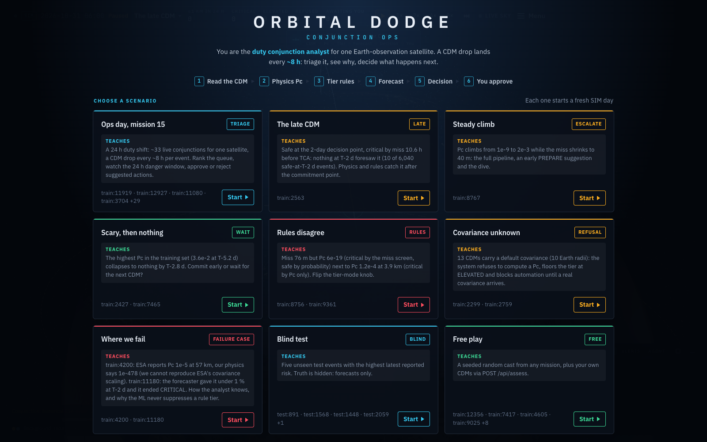
*The scenario picker. The header shows the six-step pipeline. Nine scenarios each teach one thing about the system, including where it fails.*

| # | Scenario | Focal event | What it shows |
|---|---|---|---|
| 1 | Ops day, mission 15 | `train:2563` (cast of 33 events) | A 24 h duty shift: rank the queue, watch the 24 h window, approve or reject |
| 2 | The late CDM | `train:2563` | Safe at T−2 d, critical by miss 10.6 h before TCA. The forecaster misses it; physics and rules catch it |
| 3 | Steady climb | `train:8767` | Pc climbs from 1e-9 to 2e-3 as the miss shrinks to 40 m: the full pipeline and an early PREPARE suggestion |
| 4 | Scary, then nothing | `train:2427`, `train:7465` | The highest Pc in training (3.6e-2 at T−5.2 d) collapses by T−2.8 d. Commit early or wait? |
| 5 | Rules disagree | `train:8756`, `train:9361` | Miss 76 m with Pc 6e-19, next to Pc 1.2e-4 at 3.9 km. Flip the tier-mode switch |
| 6 | Covariance unknown | `train:2299`, `train:2759` | Refusal, BLOCK, no PREPARE |
| 7 | Where we fail | `train:4200`, `train:11180` | Physics vs ESA disagreement; a forecaster false negative |
| 8 | Blind test | `test:891` (+4) | Five unseen test events with the highest latest reported risk. Truth hidden, forecasts only |
| 9 | Free play | seeded random cast | Any mission, plus your own CDMs via `POST /api/assess` |

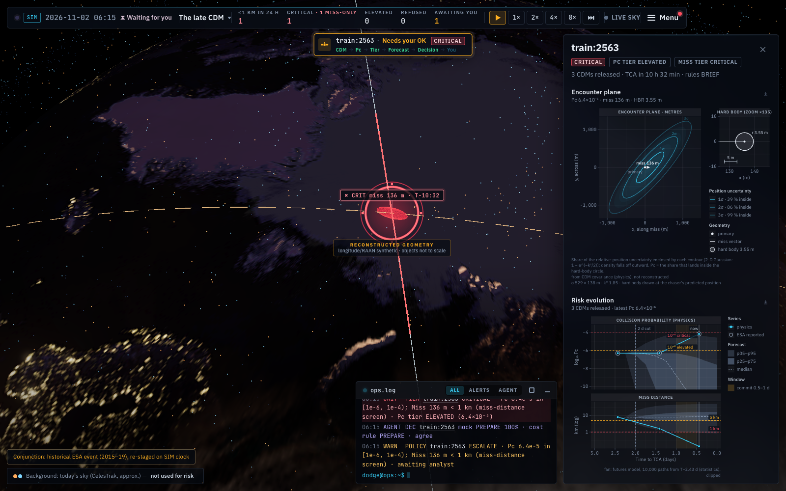
*The late CDM at the CRITICAL message: T−10:32, Pc 6.4e-5, miss 136 m, waiting for approval. **This screenshot was taken in mock decision mode** (`ops.log` shows `AGENT DEC train:2563 mock …`): the geometry, Pc, tier and forecast are real pipeline output, the decision line is the labelled mock. The inspector shows:*
- *the **encounter plane** with 1σ/2σ/3σ covariance ellipses;*
- *a **hard-body zoom** panel, which shows how small the 3.55 m hard body is next to the uncertainty;*
- *the **risk evolution** chart: physics Pc and ESA-reported risk, the futures fan (p05–p95, p25–p75, median), and labelled lines for the 2-day cut, "now", the 1e-4 critical and 1e-6 elevated thresholds.*

*This follows CARA's own display list (Vol 2 App. Q): the conjunction-plane plot, the Pc time history and the miss-distance history.*

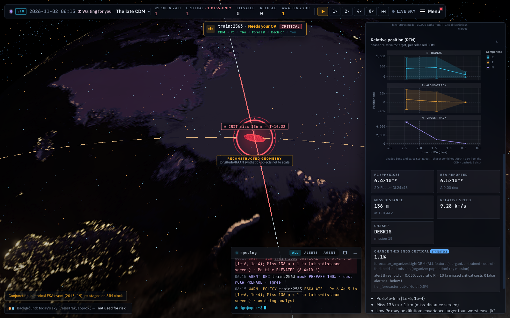
*The same moment (mock decision mode), scrolled down: radial, along-track and cross-track miss components with ±1σ bands from the CDM sigmas (CARA App. Q.6.1 says the radial miss "needs to be watched carefully"). The tiles show Pc (physics), ESA's value, the miss distance and the relative speed, and the line "chance this ends critical 1.1 %", which is the honest out-of-fold forecast that missed this event.*

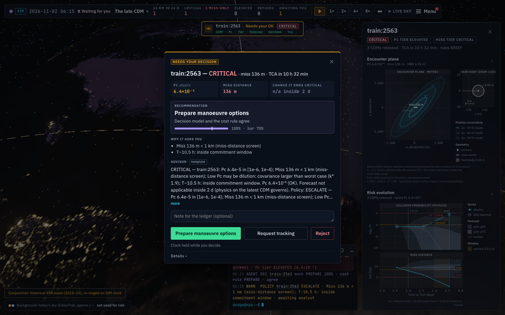
*The approval card for `train:2563` at its CRITICAL warning (mock decision mode). It shows only what the analyst needs:*
- *one headline (tier, miss, time to TCA) and three evidence tiles: Pc (physics), miss distance, and the chance it ends critical ("n/a inside 2 d", because the forecast is only valid at T−2 d);*
- *one **recommendation** (Prepare manoeuvre options), which advisor suggested it, and one bar: the decision model's probability for its pick against the 70 % bar;*
- *at most two reasons (`primary_reasons`, ranked: data quality > physics/ESA disagreement > critical rule > commitment window > model uncertainty > advisor disagreement);*
- *the **AI advisor** note: 2–3 plain sentences that say what is happening, what to do and why, and that the call is the analyst's. Every number in it is checked against the fact sheet, and a style check rejects semicolon fact lists, rule IDs and notes over 60 words (live example: "The two objects are expected to pass 136 m apart in 11 hours… I'd have flight dynamics prepare manoeuvre options for a go/no-go, since extra tracking can't arrive in time. It's your call…");*
- *a collapsed **Details** with the full audit trail (all reasons, per-action probabilities, model confidence, cost-rule losses, forecast source, t and R, ledger ids).*
- *The **LLM · VERIFIED** explanation.*
- *The button colours are fixed by action type (Prepare is always the filled green button, Request tracking the outlined one, Keep monitoring neutral), whatever the suggestion. The suggestion is the text "suggested: TRACK" at the top and the RULE tag on the cost rule's pick. We know a fixed filled "Prepare" button can read as a nudge; making the suggested action the primary button is a one-line UI change we did not make during the live demo.*

*Nothing commands a burn. The analyst chooses.*

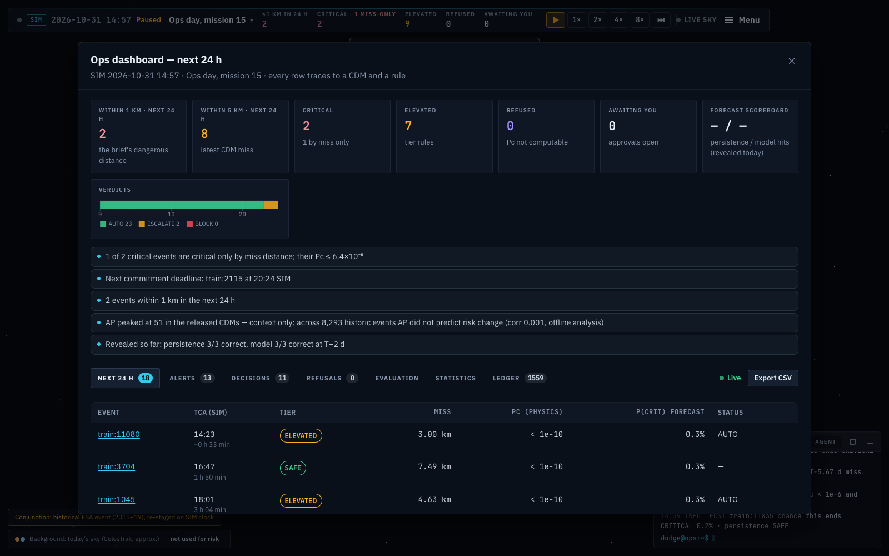
*The dashboard answers the brief's request for "warnings, in a 24 hour frame, how many come within the defined dangerous distance".*
- *Next-24 h tiles: 2 within 1 km, 8 within 5 km, 2 critical, 7 elevated, 0 refused, 0 awaiting, and the forecast scoreboard.*
- *The verdicts bar: **AUTO 23 / ESCALATE 2 / BLOCK 0**. These are 25 **policy verdicts**, not 25 decision-model calls: the DECISIONS tab shows 11 model calls. So 14 verdicts are SAFE events that never went to the model (logged as AUTO "keep monitoring"), and 11 went to the model, of which 9 were AUTO and 2 ESCALATE (derived: 25 − 11 = 14; 11 − 2 = 9). What can be AUTO is listed in §12.*
- *Five generated insights and the next-24 h table.*

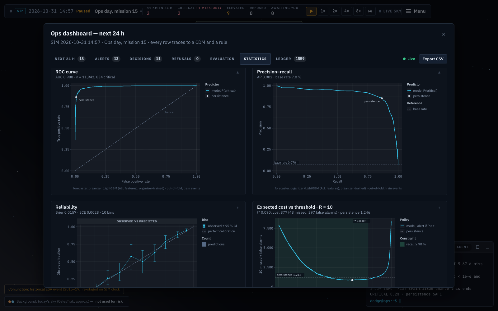
*The Statistics tab, computed from the served model's out-of-fold predictions:*
- *ROC with AUC 0.988 and the baseline operating point marked;*
- *precision–recall, AP 0.902;*
- *reliability: Brier 0.0157, ECE 0.0028;*
- *expected cost vs threshold at R = 10: the tab's optimum t\* = 0.090 gives a cost of 877 against **1,246 for the baseline**. These are totals of 10 × missed + false alarms over all 11,942 events (73.4 and 104.3 per 1,000 events). The tab uses one pooled threshold over all out-of-fold scores (48 missed, 397 false alarms). The served numbers use each fold's own threshold chosen inside its training missions (§5.5), which gives 869 (72.8 per 1,000). That is slightly lower than the pooled "optimum": the pooled curve summarises all scores under one cut-off and is not the rule we serve. Both are reproduced by `research/organizer/recompute_table.py`.*

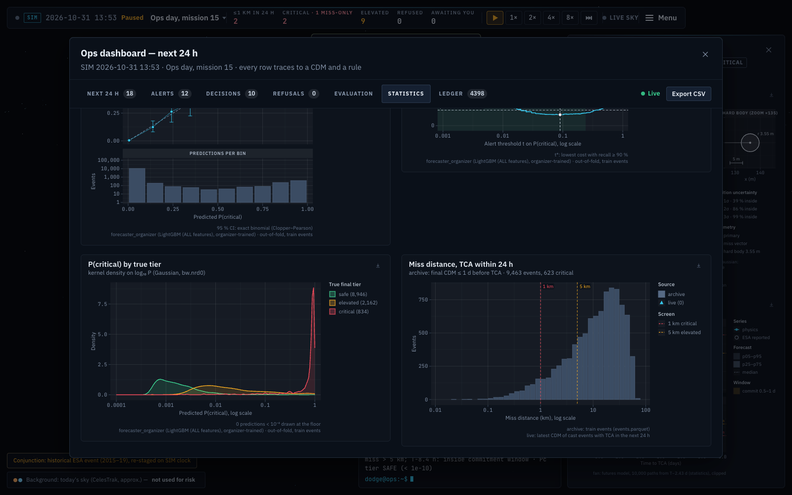
*Further down: the reliability histogram, the density of P(critical) for each true tier (how well the classes separate), and the archive miss-distance histogram (training events whose final CDM is ≤ 1 d before TCA: 9,463 events, 623 critical) with the 1 km and 5 km lines. Live events with TCA in the next 24 h are overlaid when present; in this screenshot there are none.*

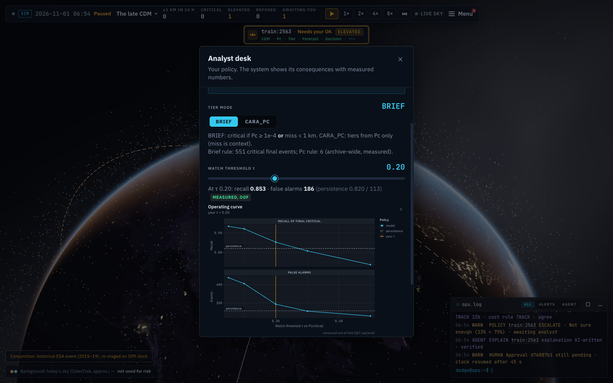
*The Analyst desk holds the operator's policy in plain language:*
- *the BRIEF / CARA_PC tier-mode switch;*
- *the watch threshold (this screenshot predates the change: the desk now defaults τ to the served model's 0.0634 alert threshold; it showed 0.20), labelled **MEASURED OOF**. Its figures come from the **v1 tier forecaster** (HGB on the 13 brief columns, by-event OOF on the Kelvins-eligible 8,293 events, 551 critical; `registry/tier_forecaster/1.0.0/metrics.json` → `by_event.operating_curve_calibrated`, served by `/api/eval`), not from the served organizer model: recall 0.853 with 186 false alarms, against the baseline's 0.820 with 113. On the served model's held-out-mission OOF (organizer population, 834 critical), τ = 0.20 gives recall 0.909 with 214 false alarms (`recompute_table.py`);*
- *the full operating curve.*

*Policy changes are versioned and written to the ledger. The threshold table in §5.5 lists how τ_watch relates to the alert thresholds.*

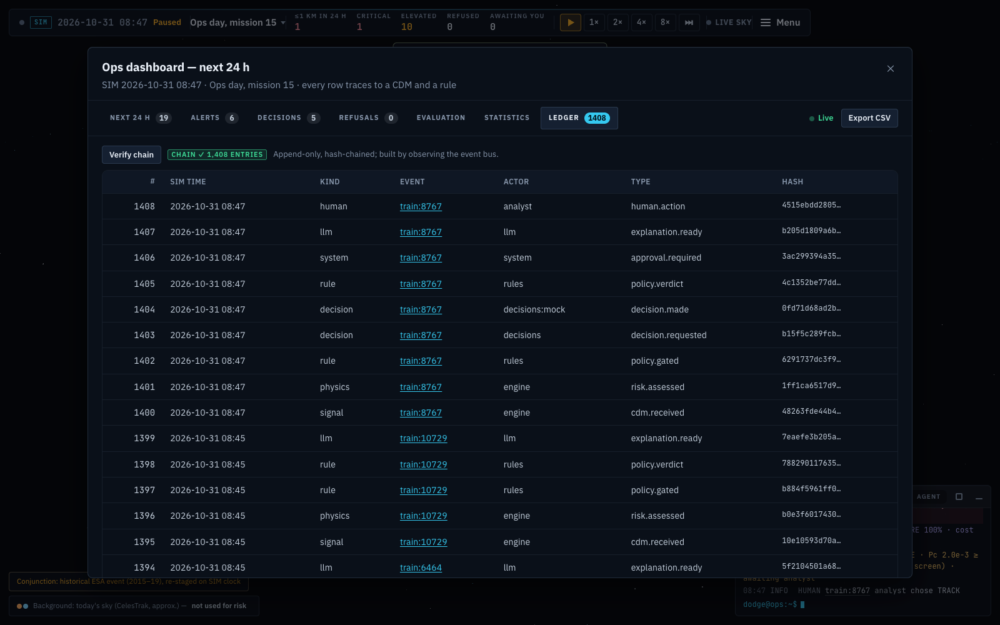
*The Ledger tab after "Verify chain": `CHAIN ✓ 1,408 ENTRIES` (mock decision mode: the decision rows' actor is `decisions:mock`). The newest rows come first: human.action, llm, system, rule, decision, physics and signal entries, each with its hash.*

---

## 10. Live sky: our own screening of today's catalogue

The brief asks for "trajectories … in a 24 hour frame". The dataset events are historical, so we also **screened today's real sky ourselves** on Triologay ([`research/livesky/REPORT.md`](research/livesky/REPORT.md), output [`data/livesky/latest.json`](data/livesky/latest.json)).

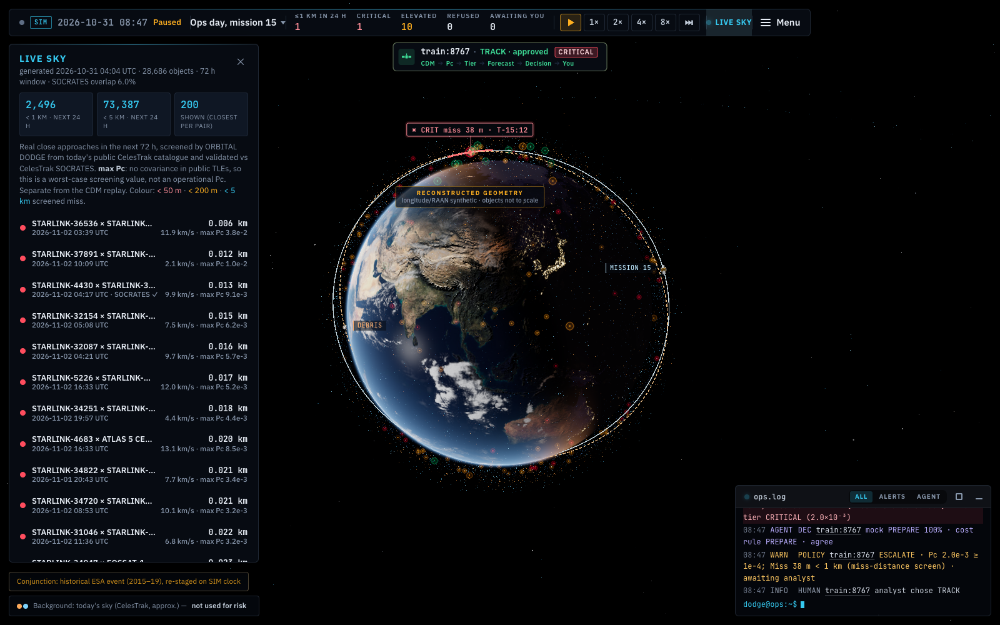
*LIVE SKY on: real close approaches from our own screening of the CelesTrak catalogue (28,686 objects; 2,496 approaches under 1 km in the next 24 h, excluding formation pairs), sorted by miss distance and plotted on the globe.*

| Item | Value |
|---|---|
| Objects screened | 28,686 of 30,654 catalogued (perigee < 2,000 km, element sets < 30 days old) |
| Window, step | 72 h, 10 s |
| Events < 5 km / < 1 km | 334,820 / 24,710, across 193,319 pairs |
| Next 24 h < 1 km | 4,402, of which **2,496 exclude formation pairs** (398 formation pairs, e.g. TanDEM-X / TerraSAR-X) |
| Runtime | 156 s in total (SGP4 21.5 s on 52 processes; GPU spatial hash 21.6 s, peak 3.43 GB) |

**Validation against CelesTrak SOCRATES:**
- With the **same element sets** (n = 1,746): recall **97.1 %** (< 5 km) and **88.0 %** (< 1 km), median range difference **0.3 m**.
- Over all events, recall is 28.8 %. The gap comes mostly from **element age**: SOCRATES used elements about 1.8 days old, ours are newer.
- Our top-200 list overlaps SOCRATES by 6 %.

**The limit is shown in the UI:** public element sets have no covariance, so we report only a worst-case "max Pc". This layer is context. It is **never** used for the dataset events' risk.

---

## 11. How we tested it locally

Everything below ran on the development MacBook (M2, 8 GB) unless stated otherwise. The heavy ML ran on Triologay (§5.4).

### 11.1 Backend test suite: 168 tests, all passing
```bash
make test        # = cd server && .venv/bin/python -m pytest -q
# 31 Oct 2026, mock mode (C1_MOCK_AI=1):  168 passed in 13.92s
```

| File | Tests | What it covers |
|---|---|---|
| `test_policy.py` | 71 | Allowed-action gating per tier and flag; every AUTO / ESCALATE / BLOCK path; CRITICAL is never AUTO; PREPARE is never automatic; policy patch validation |
| `test_rules.py` | 19 | The brief's tier table, BRIEF vs CARA_PC modes, the sentinel, low-v_rel, physics-disagreement and MCP rules |
| `test_pc_physics.py` | 13 | **Property-based (Hypothesis):** Pc ∈ [0, 1]; symmetric when the objects are swapped; rotation-invariant; decreasing in miss distance; increasing in HBR. Also small-sigma limits, published reference vectors, **Monte Carlo agreement**, and batch = row API |
| `test_verifier.py` | 11 | The LLM number verifier: accepts rendered facts and unit conversions within 1 %; rejects invented numbers, Pc as a percent, unknown placeholders and forbidden action phrases |
| `test_pc_golden.py` | 7 | **Golden tests on real data:** a 5,000-row random sample vs `risk`; all high-band rows; the four golden events `train:2563`, `train:2299`, `train:4200`, `train:8756` |
| `test_perf_honesty.py` | 7 | Training events never get in-sample forecasts; forecast sources plug in; tier-mode re-run works; scenario load pre-empts an in-flight AI call |
| `test_forecast.py` | 6 | **The forecast never suppresses a rule tier** (property and OOF checks); valid forecast window; event path = batch path; metric and artifact alignment |
| `test_providers.py` | 6 | Timeout and error fall back to mock; "all refuse" is a refusal, not a mock; Jev vote shares and routing; too few votes caps confidence; cache; TypeSafe request body and parsing |
| `test_api.py` | 5 | Health; JSON 404/400; a full approve flow; `/api/ask` refuses out-of-scope questions; `/api/assess` on ad-hoc rows |
| `test_ledger.py` | 5 | Chain verifies; UPDATE and DELETE raise; tampering is detected at the exact seq even after a re-hash; reopening continues the chain |
| `test_contract.py` | 4 | SSE JSON Schema is up to date; every scenario's events validate; *Covariance unknown* blocks; *The late CDM* escalates on CRITICAL |
| `test_replay.py` | 2 | **Replay determinism:** two mock runs produce identical content hashes; ops-day is deterministic and complete |

### 11.2 Leakage and reproducibility audits ([`research/bakeoff/audit/`](research/bakeoff/audit/))
| Audit | What we did | Result |
|---|---|---|
| **Noise substitution** (`a2_perturb_late_cdms.py`) | Replaced all **50,695** CDM rows with `time_to_tca < 2 d` (the future the model must not see) with noise, then rebuilt every feature | **Bit-identical** A13 and ALL feature matrices and sequences. No future data leaks into the inputs |
| **Shuffled labels** (`a3`, `a5`, `a6`) | Retrained with permuted labels | LightGBM with shuffled labels: AUC 0.45–0.55 (a3), per-fold means 0.51–0.54 (a5), which is chance level. The TabPFN shuffle nulls (a6) were noisier: AUC 0.38 and 0.67 for two seeds, uncorrelated with each other (Spearman 0.01). A shuffle **within** each mission keeps each mission's critical rate, so some signal can survive it; it gave 0.67 (a3). We read this as no hidden label signal in the LightGBM pipeline, with a noisy null for TabPFN |
| **Exact reproduction** (`a3_lgbm_repro_shuffle.py`) | Re-ran lgbm_all by mission and by event | Max absolute difference **0.0** |
| **Data, labels, folds** (`a1_data_labels_features.py`) | Independent rebuild | 0 label mismatches; no mission appears in more than one fold; two copies of the folds are equal. The independent feature recompute found **11 cell mismatches** (10 on sigma-delta features of event 5826, where the recompute gives NaN and the stored matrix a number; 1 on a covariance-determinant slope of event 8154), **1 missing column** (`last_c_object_type`), and flagged 3 features for review (`last_relative_velocity_r/t/n`) |
| **Seed sensitivity** | lgbm_all on other seeds | PRIMARY 0.828–0.842. The pre-registered seed 0 sits at the top of the range, and we say so |
| **Final-fit check** | The registry's `predict.py` vs the exported predictions | Exact match; refit-on-all agrees at r = 0.995 |

### 11.3 End-to-end runs against a real backend (headless)
We started a **separate** backend and Vite on our own ports (backends 8031 and 8032, Vite 5191), never the demo's :8000/:5173. We drove **7 of the 9 scenarios at 8×** (all except *Blind test* and *Free play*). **These runs used mock mode** (`C1_MOCK_AI`): both backend logs start with `ready decisions=mock … llm=template`, so the decision calls below are the labelled mock (a softmax of the cost rule) and the text is the deterministic template. They test the pipeline, the policy, the SSE contract, the API and the ledger, not Jev or the LLM verifier. The live-mode evidence for Jev and the verifier is the approval screenshot in §9 (typesafe-jev, 476 ms, **LLM · VERIFIED**) and the 11 verifier tests.

The sanitised results are committed in [`docs/evidence/e2e/`](docs/evidence/e2e/): [`summary.json`](docs/evidence/e2e/summary.json), the runner's own [`stories_report.json`](docs/evidence/e2e/stories_report.json), [`ops_day_dashboard_check.json`](docs/evidence/e2e/ops_day_dashboard_check.json) and the UI runner's screenshots in [`ui/`](docs/evidence/e2e/ui/). [`make_summary.py`](docs/evidence/e2e/make_summary.py) rebuilds them from the raw working folder (`var/e2e/`, git-ignored because it holds SQLite ledgers and full SSE dumps).

| Runner | What it does | Result (mock mode) |
|---|---|---|
| **API + SSE story runner** (`run_stories.py`) | Loads each scenario, listens to the SSE stream, auto-approves, and checks `/api/conjunctions/{key}` and `/geometry` for every cast member | 5 scenarios (*Steady climb, Scary then nothing, Rules disagree, Covariance unknown, Where we fail*): **1,805 SSE events of 15 types**, **48 policy verdicts** (36 ESCALATE, 7 BLOCK, 5 AUTO), 43 mock decision calls, 0 fallbacks, **0 HTTP errors** (146 responses, all 200). Every focal event's endpoints returned 200. **Ledger verify OK over 729 entries** |
| *The late CDM* (same runner, separate events file) | As above | 84 SSE events. Verdicts in order: AUTO Monitor, AUTO Request tracking, then **ESCALATE** with an approval card on the CRITICAL CDM |
| **Dashboard cross-check** (`check_dashboard.py`) | Runs *Ops day* at 8×, approves what it is asked, pauses, then recomputes the 24 h tiles from the event data and compares | **5 of 5 tiles match** (within 1 km 2, within 5 km 8, critical 2, elevated 7, awaiting 0) over a cast of 33. Verdicts AUTO 28 / ESCALATE 2 / BLOCK 0, with 11 decision calls. Backend: 666 responses 200 and 6 × 409 Conflict, which are the runner re-posting approvals that were already resolved |
| **Headless Chrome UI runner** (`ui_stories.py`, Chrome DevTools Protocol) | Opens the UI, plays a scenario, takes screenshots at key moments, and collects console errors, uncaught exceptions and HTTP responses ≥ 400 | Run on *The late CDM*: 3 screenshots saved (start, approval card, agent popover). Its console and network lists were printed but not saved (the log file is empty), **so we claim no console or HTTP numbers for the UI** |
| **Ad-hoc input** | Posted 5 real CDM rows of one event to `POST /api/assess` as a CSV body and as a multipart upload | Pc, tier and rule ids returned for all 5 rows in both forms (saved responses [`assess_csv.json`](docs/evidence/e2e/assess_csv.json), [`assess_mp.json`](docs/evidence/e2e/assess_mp.json)). JSON input is covered by `test_api.py`. The system is not limited to the scripted scenarios |

### 11.4 Run it yourself
```bash
make setup        # Python 3.13 venv (uv) + npm install
make precompute   # ingest → physics Pc → train (v1 tier forecaster) → events → test predictions → scenarios
make test         # 168 backend tests
make dev          # backend :8000 + Vite :5173 → open http://localhost:5173
```

**Check the headline table in one command, without the dataset and without retraining.** It needs only the committed out-of-fold file [`registry/forecaster_organizer/1.0.0/oof_organizer.parquet`](registry/forecaster_organizer/1.0.0/oof_organizer.parquet):
```bash
server/.venv/bin/python research/organizer/recompute_table.py
# baseline (tier at T-2 d)                 722 caught, 112 missed, 126 FA, cost 1246 = 104.3 per 1,000, AUC 0.969, macro-F1 0.898
# ORBITAL DODGE served (per-fold thresholds)  791 caught,  43 missed, 439 FA, cost  869 =  72.8 per 1,000, AUC 0.988, macro-F1 0.893
# plus the global-0.0634, pooled-0.090 and watch-0.20 variants, and each fold's threshold
```
These are the §6.2 point estimates. The bootstrap CIs come from [`research/organizer/results.json`](research/organizer/results.json).

- **Data layout.** The dataset and the organizer's label files are not redistributed. Place them exactly like this (`data/raw/` is git-ignored):
  ```
  data/raw/Challenge 1 Airbus /train_data.csv     # note the trailing space in the folder name;
  data/raw/Challenge 1 Airbus /test_data.csv      #   override with C1_RAW_DIR=/path/to/folder
  data/raw/organizer/train_event_labels.csv
  data/raw/organizer/tier_rules.csv
  data/raw/organizer/data_notes.csv
  data/raw/organizer/challenge1_event_labels.xlsx
  ```
- **Precompute time and hardware.** `make precompute` is CPU-only (pandas, NumPy, scikit-learn HGB) and needs no GPU. We did not record a timed run on the 8 GB M2, so we give no runtime; `run_all` prints its own total when it finishes. `python -m pipelines.run_all --skip-train` reuses the committed registry. Note that `make precompute` retrains the **v1 tier forecaster** used for the test-set CSVs. The **served** organizer model is built by `research/organizer/organizer.py build|eval|final` (LightGBM, capped at 8 cores; its evaluation log records about 533 s for `eval`, [`research/organizer/out/eval.log`](research/organizer/out/eval.log)). The GPU jobs in §5.4 (sweep, risk futures, TabPFN, live-sky) needed Triologay, and none of them is needed to run the app.
- **Keys:** copy `.env.example` to `.env`. Every key is optional: `C1_TYPESAFE_API_KEY` (Jev, official API), `C1_JEV_API_KEY` (the `jev-router` fallback), `C1_ANTHROPIC_API_KEY` (Claude explanations), `C1_OPENAI_API_KEY`, `C1_OPENROUTER_API_KEY`.
- **Mock mode:** without keys, or with `C1_MOCK_AI=1`, the app runs in **labelled** mock and template mode (mock decisions are a softmax of the cost rule's losses, and the text comes from deterministic templates).
- **Replay mode:** `C1_REPLAY=1` serves decisions only from the on-disk cache.
- **Endpoints** (29 route handlers; 28 if `GET|PUT /api/policy` counts as one):
  - simulation: `GET /api/state`, `GET /api/scenarios`, `POST /api/sim/{scenario,speed,pause,resume,next-cdm}`, `GET /api/events` (SSE);
  - operations: `GET|PUT /api/policy`, `GET/POST /api/approvals`, `GET /api/ledger`, `/ledger/verify`, `/ledger.jsonl`;
  - data: `GET /api/conjunctions/{key}` (+ `/geometry`, `/rtn`), `GET /api/dashboard`, `GET /api/eval`, `/eval/curves`, `POST /api/assess`, `GET /api/livesky`, `GET /api/futures/{key}`, `GET /api/models`, `/models/{name}/card`, `GET /api/predictions/{fname}`, `POST /api/ask`, `GET /api/health`.

---

## 12. Impact: before and after for the analyst

**Measured** on held-out missions (11,942 organizer events). Per-1,000 and per-100 values are derived by dividing the totals in §6.2:

| For the analyst | Today (baseline at T−2 d) | With ORBITAL DODGE | Change |
|---|---|---|---|
| Criticals flagged 2 days ahead | 722 of 834 (86.6 %) | **791 of 834 (94.8 %)** | +69 caught early |
| Criticals discovered late, per 1,000 events | 9.4 | **3.6** | −62 % |
| False alarms per 1,000 events | **10.6** | 36.8 | +26 per 1,000 |
| CRITICAL alerts per 100 events | 7.1 | 10.3 | +3.2 |
| Precision of a CRITICAL alert | **85 %** | 64 % | about 1 in 3 alerts is false |
| Expected cost per 1,000 events (R = 10) | 104.3 | **72.8** | **−30 %** |
| Expected cost at the *central* evidence ratio R = 6 (derived) | 66.8 | **58.4** | −13 % |

**When the trade is worth it (derived).** We pay 313 extra false alarms for 69 extra criticals caught, about **4.5 false alarms per critical**. The model therefore has the lower expected cost for **any R above ~4.5** (4.7 on the 80/20 split). That includes the evidence-based central value (6.0) and median (5.1), as well as the chosen 10. It is not cheaper at the low tail of the evidence (P10 = 2.4). An operator whose costs sit there should re-derive the alert threshold for their own R; COST_RATIO §4 already asks for R = 5 and R = 20 sensitivity rows. These figures keep the threshold fixed at its R = 10 value. A threshold re-tuned for a lower R would do better than shown here.

**In euros (estimate, not measured).** We use the central costs from [COST_RATIO.md](docs/COST_RATIO.md): €1,120 per false alarm and €6,750 per late critical. That gives about €65k vs €75k per 1,000 events, a saving of ≈ €9.6k per 1,000 events. These costs are assumptions bounded by the cited evidence.

**Workload, as shown in one demo shift (not a measured workload reduction).** The *Ops day* dashboard screenshot shows **25 policy verdicts: 23 AUTO (logged within policy) and 2 ESCALATE to the analyst**, each escalation with its evidence, reasons and explanation. Read it with these limits:
- **What can ever be AUTO** ([`policy.py`](server/decisions/policy.py)): only *Keep monitoring* or *Request tracking*, and only on a SAFE or ELEVATED event with no data-quality flag. A SAFE event that is not on watch is logged as AUTO *Keep monitoring* without calling the decision model. Anything else goes to the model and is AUTO only if the model gives its pick at least 70 % probability **and** (in live mode) it picks the same action as the time-aware expected-cost rule (tracking only counts as useful with at least ~1 day to TCA). Any disagreement escalates. CRITICAL, *Prepare manoeuvre options*, a default covariance, a physics/ESA disagreement and a low relative speed are never AUTO.
- **In this shift,** 14 of the 23 AUTO verdicts were SAFE events that never reached the model, and 9 came after a model call (the DECISIONS tab shows 11 calls; derived: 25 − 11 = 14, 11 − 2 = 9). The screen does not show whether that session's decisions were live or mock. In mock mode the decision is the cost rule's own choice, so the cost rule agrees by construction. In live mode an AUTO verdict means Jev and the cost rule agreed.
- **The decision model (Jev) is not validated offline** (§8, §15). The workload figure counts verdicts from one replayed shift of 33 events. It is not a measured reduction in analyst hours.

**Adoption constraints we acknowledge:**
- The system needs the operator's CDM feed with full covariance.
- Per-mission performance varies (§8 #7).
- The thresholds should be re-validated on the operator's own labelled history before use.
- The analyst's team must accept about 1 false alarm in 3 alerts.

---

## 13. Time discipline

Built on 31 October 2026, the hackathon day. There were 12 commits before this README (`git log`); the README, the evidence files and the recompute script are committed after them, so **the recorded submission time is the time of the final commit on the pushed branch** (`git log -1 --format=%ci`).

| Time | Commit | What |
|---|---|---|
| 11:37 | `e80427c` | Research and system design (domain research, dataset experiments, final design) |
| 12:21 | `e9d9449` | Risk engine, offline pipeline, forecaster registry, live-sky screening |
| 12:33 | `54962a8` | FastAPI backend: SSE sim loop, decision and LLM layers, hash-chained ledger |
| 12:34 | `a2c1734` | Risk-futures model, conformal alerts, optimal decision policy results |
| 12:34 | `69ce333` | Fan charts for scenario events |
| 12:42 | `20fe687` | 3D Earth simulator and mission-console UI |
| 13:09 | `52ee7a8` | TypeSafe's official Jev API as the primary decision model |
| 13:16 | `2044eb8` | Evaluation on the organizer's official label set and population |
| 14:02 | `1ddfa4e` | Serve the organizer-trained forecaster; model search results and docs |
| 14:05 | `ef4b155` | Hand-drawn dark ggplot-style charts, statistics tab, integration fixes |
| 14:07 | `3eefbe8` | Keep ops.log clear of the wider chart inspector |
| 14:21 | `d390e01` | Stream per-axis CDM sigmas and shade ±1σ on the RTN chart |

We spent the time in this order: research and design first, then physics and rules, then measurement, then the interface. When the organizer's labels arrived, we re-evaluated on them **before** polishing.

**3-minute demo script** (live demo on `make dev`, *Ops day* and *The late CDM* scenarios):

| Time | What we show | Point made |
|---|---|---|
| 0:00–0:40 | The duty analyst and the status quo: hundreds of alerts per satellite per week, one number per CDM, no forecast, no record of which rule fired. Open *Ops day*: globe, HUD, queue, `ops.log` | Problem realism: a named user and a narrow workflow |
| 0:40–1:30 | *The late CDM* at 8×: SAFE at T−2 d with a 1.1 % forecast, then CRITICAL at 136 m on the late CDM. Rules fire anyway, the clock holds, the approval card opens | Where it fails, and how the analyst knows. The ML cannot suppress a rule tier |
| 1:30–2:20 | The approval card: rule ids, forecast source and fold threshold, Jev's bars beside the cost rule, "not a collision probability", LLM · VERIFIED. Approve with a note, then Dashboard → Ledger → Verify chain ✓ | Trust and traceability: a human decides and every step is hash-chained |
| 2:20–3:00 | Results against the baseline: 94.8 % vs 86.6 % of criticals caught 2 days ahead on held-out missions, cost −30 %, the price of 3.5× more false alarms, the macro-F1 tie, and the one-command recompute | Honest evaluation and impact |

---

## 14. Repository map

```
server/                 FastAPI backend (Python 3.13)
  riskengine/           pc.py (2D Pc) · rules.py (tiers, gates) · forecast.py · features.py · orbits.py
  decisions/            policy.py (gate + verdict) · expected_cost.py (baseline) · typesafe.py (Jev) · provider.py (chain)
  llm/                  factsheet.py · templates.py · explain.py · verify.py (number verifier) · ask.py
  ledger/ledger.py      hash-chained SQLite ledger
  app/                  main.py · simloop.py (SIM clock, pipeline) · sse.py · approvals.py · api/ (REST)
  pipelines/            ingest → precompute_pc → build_events → train → build_scenarios → predict_test (run_all.py)
  tests/                168 tests (unit, golden, property-based, contract, replay, honesty)
game/                   Vite + three.js simulator and UI (src/world, src/ui), CREDITS.md
shared/                 scenarios/*.json (9 scenarios) · schema/events.schema.json (SSE contract) · CONTRACT.md
registry/               forecaster_organizer/1.0.0 (served) + 1.1.0 (alternative) · forecaster_bakeoff · tier_forecaster
                        futures · conformal · policy (model cards, metrics, OOF and test predictions)
research/
  organizer/            evaluation on the organizer's labels (results.json = headline numbers; recompute_table.py)
  bakeoff/              PREREG.md (+sha256), harness, leaderboard, audit/ (leakage and repro audits)
  bigml/                risk futures, conformal, decision policy (REPORT.md, results.json)
  fa/                   false-alarm reduction study (select/results.json)
  livesky/              GPU screening of today's catalogue (REPORT.md, screen.py)
  experiments/          first-day dataset experiments (physics validation, baselines, orbits)
predictions/            test_events.csv (2,167 events) · test_rows.csv (24,484 CDMs)
data/livesky/latest.json  live-sky screening output
docs/
  FACTS.json            source index for every number in this README
  COST_RATIO.md         derivation of R = 10
  BAKEOFF.md            pre-registered bake-off and verdict
  design/               00 context · 11 dataset experiments · 12 domain research · 13 tech research · 40 final design
  evidence/e2e/         sanitised end-to-end results (summary.json, dashboard check, UI screenshots)
  screenshots/readme/   screenshots used above
  images/               Triologay photo
JUDGING.md              criteria → evidence, 5-minute check
Makefile                setup · precompute · test · dev · server · game
```

---

## 15. Limits and next steps

**Limits:**
- **Historical data.** The dataset is ESA's 2015–2019 archive, re-staged on a SIM clock. We have not run the system on a live operator feed.
- **Hidden test labels.** The test set is unscored here. All accuracy claims are on training events, out-of-fold, by event and by held-out mission.
- **The brief's tier definition.** "Critical" is mostly a miss-distance tier: 549 of 551 eligible criticals. CARA warns against miss-only screening (Vol 2 App. M.2). We follow the brief by default and expose CARA_PC mode as a switch.
- **More false alarms.** The false-alarm rate is higher than the baseline (36.8 vs 10.6 per 1,000 events). This is deliberate at R = 10. On the desk the operator can edit the loss table, the watch threshold and the confidence bar, and every change is versioned in the ledger. The CRITICAL alert threshold itself is re-derived from R offline.
- **The Jev decision model is not offline-validated.** It is a second opinion beside a transparent cost rule.
- **The end-to-end runs used mock decisions and template text** (§11.3). Live Jev calls and the LLM verifier are shown in the approval screenshot and covered by unit tests, not by a recorded live end-to-end run.
- **Reconstructed geometry.** The 3D orbits of the dataset events are reconstructions, and the live-sky Pc is a worst-case bound without covariance.

**Next steps, in priority order:**
1. A futures + LightGBM combination for late escalations, since futures would have flagged `train:2563` at the 95 % conformal threshold.
2. Model the miss-distance clause directly, with a predictive interval on the final miss.
3. Offline evaluation of the decision model against the expected-cost rule on held-out events, pre-registered.
4. Per-mission calibration and conformal coverage once an operator's own labelled history is available.
5. Re-derive R with an operator's real costs (COST_RATIO §5).

---

## 16. Credits and data

- **Data:** the ESA Kelvins Collision Avoidance Challenge CDM dataset, as provided by the hackathon organizers, with their official event labels and tier rules. It is not redistributed here.
- **Method references:**
  - Uriot et al., "Spacecraft Collision Avoidance Challenge", *Astrodynamics* 6(2), 2022 (arXiv:2008.03069);
  - NASA CARA Conjunction Assessment Handbook (NASA/SP-20205011318), Rev 2 Vol 2;
  - CCSDS 508.0-B-1 (CDM);
  - 18/19 SDS Spaceflight Safety Handbook;
  - NASA OTPS 2023 cost study;
  - ESA Space Debris Office pages.

  The full source list with URLs is in [docs/design/12-domain-research.md §9](docs/design/12-domain-research.md) and [docs/COST_RATIO.md §6](docs/COST_RATIO.md).
- **Live data:** CelesTrak GP (OMM) and SOCRATES (celestrak.org).
- **Models and services:**
  - TypeSafe Jev (decision model, official System One API);
  - Anthropic Claude (explanations only);
  - LightGBM, scikit-learn, TabPFN, InterpretML EBM, PyTorch, Optuna, python-sgp4.
- **Front end:** three.js and NASA Blue Marble / Black Marble textures via the three.js examples. Full asset licences are in [game/CREDITS.md](game/CREDITS.md).
- **Compute:** Triologay, the team's own GPU server.
