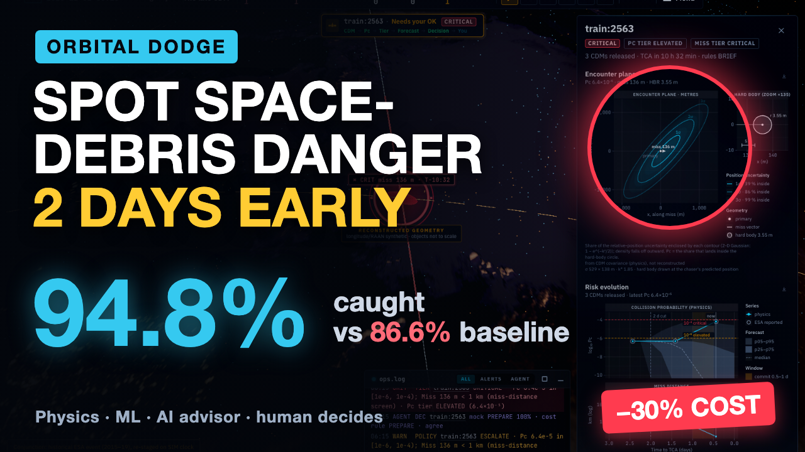

# Submission summary

**One-liner:** ORBITAL DODGE tells a satellite operator which collision warnings will turn dangerous, two days before they do.

**Summary:**
Every week a satellite operator receives hundreds of collision warnings. Almost all are false alarms, but the few real ones have to be decided about a day before the encounter. ORBITAL DODGE reads each warning, recomputes the collision probability from first principles (matching ESA's own figures on 98.97 % of tiers), and forecasts whether the encounter will still be critical when it matters. TypeSafe Jev recommends what to do, Claude Sonnet 5.5 explains why in plain English, and the analyst makes the call on a single decision card. Every step is recorded in a tamper-evident ledger and plays out on a live 3D Earth. Tested on the organizer's official labels and on missions it never saw, it catches 94.8 % of critical events two days early, against 86.6 % for the baseline, at 30 % lower expected cost.
