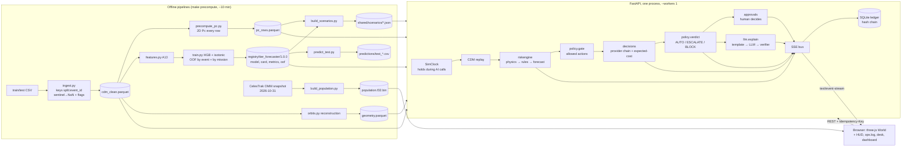
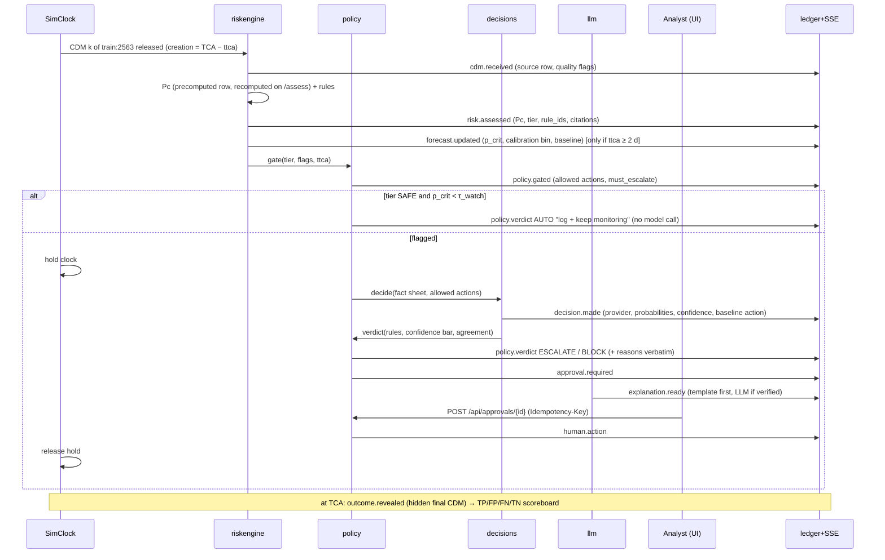

# 40 — Final system design: CLOSE CALL (Challenge 1, Airbus track)

Status: build spec for today (31 Oct 2026). One builder (Claude). Supersedes the open questions in 10–13.
Inputs: `00-context.md`, `10-reference-style.md`, `11-dataset-experiments.md` (+ raw `SCRATCH/exp/w2/out/b_baselines.txt`,
`b2_kelvins.txt`), `12-domain-research.md`, `13-tech-research.md`. `SCRATCH` = the session scratchpad named in 11.

Tags: **MUST** (demo breaks without it) · **SHOULD** (planned, cut in order of §10) · **STRETCH** (only if ahead).
"Product name" CLOSE CALL and log prompt `closecall@ops` are placeholders (§14).

Ground rule, enforced in code and tests: **physics computes Pc, rules compute tiers and what is allowed, statistics
forecast. The decision model picks among allowed actions; the LLM explains. Neither computes Pc, a tier or legality.
A human approves every action that is not "keep monitoring".**

---

## 1. User, status quo, cost, pitch

| | |
|---|---|
| **Named user** | The **duty conjunction analyst** for one LEO Earth-observation satellite in an operator's flight-dynamics / space-debris office. Model: ESA SDO supporting Sentinel, CryoSat, Swarm. Our data *is* that office's 2015–2019 CDM archive (19 missions). The demo operator is **mission 15** (1,769 train events; median 6 live events per mission-day, p90 13 across missions, 11 §D). |
| **Job** | Every ~8 h a CDM drop arrives (median spacing 8.07 h, 11 §D). Triage each event, keep ~2 per satellite per week under detailed watch, and recommend go / no-go at the **manoeuvre commitment point (MCP), 0.5–1 d before TCA** (CARA Vol 2 App. F). |
| **Status quo** | Per-CDM threshold checks on the reported Pc and miss distance in in-house tools or the CARA MATLAB SDK, plus spreadsheets and e-mail. One number per CDM, no forecast, no trace of which rule fired. ESA: "hundreds of alerts per week" per satellite, ~2 need follow-up, each takes "hours of analysis" (ESA *Automating collision avoidance*). |
| **Cost of a false alarm** | Δv and propellant, science outage around the burn, possible restoration burn, analyst hours. CARA: switching to more conservative metrics would multiply manoeuvres ×8–9, "unbearable" (Vol 2 App. M.5). |
| **Cost of a miss** | Loss of the satellite and a new debris cloud (FY-1C, Iridium-33/Cosmos-2251 fragments are still tracked: 1,980 / 109 / 584 objects in today's CelesTrak snapshot). |
| **Hidden data hazards the status quo shows as numbers** | 3.2 % of CDM rows (5,129 rows, 1,313 events) carry a default covariance (σ = 63,781,363 m) and a meaningless reported risk of ≈ −14.3. 905 events end with miss < 1 km, yet 571 of them have Pc ≤ 1e-10 (11 §A, §F). |

**Pitch (one sentence):** CLOSE CALL turns each 8-hourly CDM drop into a traced triage queue for the duty analyst: it
recomputes Pc from the covariance, applies the CARA/ESA tier rules, says which events will likely still be red at the
manoeuvre commitment point, and hands the analyst a suggested action with its evidence, while refusing to certify any
event it cannot assess.

---

## 2. Architecture

### 2.1 Layer cake (the team's order, top to bottom) and the naive baseline beside each layer

| # | Layer | Job (only this) | Naive baseline shown next to it | Earns its place if… | Status |
|---|---|---|---|---|---|
| 5 | **Decision model** (OpenAI Decisions API → Jev → mock) | Pick one action among the **rule-allowed** actions for a flagged event, with a probability per action | **Expected-cost rule** on calibrated P(critical) and a loss table (§4.4) | On 400 held-out events it has total loss ≤ baseline **and** missed criticals ≤ baseline; otherwise labelled "second opinion" | Measured at H9, pre-registered |
| 4 | **LLM** (Claude Sonnet 5.5; Opus 5.5 for the daily brief) | Read the fact sheet, explain, answer questions, write the 24 h brief | **Deterministic template text** (always rendered first) | Verifier pass rate ≥ 90 % and 0 unverified numbers on screen | Measured on every call |
| 3 | **ML forecast** (sklearn HGB on the 13 allowed columns, isotonic-calibrated) | P(final tier = CRITICAL) at T−2 d; queue ranking | **Tier persistence** (latest ≥ 2 d tier), persistence-empirical P(crit), **LRP** for the Kelvins value | Ranks better (AUC 0.980 vs 0.958, measured). Does **not** beat persistence as an alarm at matched recall (117 false alarms at recall 0.822 vs 113 at 0.820), so it can **add** attention, never remove it | Measured by event; by mission at H2 |
| 2 | **Rules engine** | Tier (brief thresholds), data-fitness gates, allowed actions, AUTO/ESCALATE/BLOCK | **Miss-distance-only screen** (what a naive dashboard does) | Always (compliance is code) | Table-driven tests |
| 1 | **Physics** | 2D Pc per CDM from the full covariance | Reported `risk` column; crude 13-column isotropic Pc | Median 0.059 dex vs ESA risk; tier agreement 98.97 % (measured) | Golden tests |

### 2.2 System diagram



### 2.3 Service boundaries

| Boundary | Owns | Never does |
|---|---|---|
| `riskengine/` (pure Python, no I/O except Parquet) | cleaning, physics Pc, rules, features, forecast, baselines, evaluation, orbit reconstruction | network, LLM, clocks (`now` is injected) |
| `decisions/` | gating → request → provider chain → normalise → expected-cost baseline → verdict | compute Pc or tiers; see the baseline's chosen action when asking the model |
| `llm/` | fact sheet → structured text with placeholders → render → verify → fallback | write any number not in the fact sheet; recommend an action other than the verdict |
| `app/` (FastAPI) | sim loop, SSE, REST, approvals, ledger, idempotency, config, health | business logic (delegates to the three packages) |
| `game/` (browser) | rendering, propagation of *display* orbits, UI state | any risk logic (the Director only maps events to world calls, as in the reference) |

### 2.4 One CDM through the system



---

## 3. Risk engine

### 3.1 The "13 columns only" decision (stated)

**Decision:** the 13 columns are the **operator-facing view and the ML feature set**. The **physics evaluator also reads the
covariance columns** because the brief's own first requirement ("calculates Pc … per NASA CARA") is physically impossible
from radial sigmas alone. Measured: an isotropic Pc from `t_sigma_r`, `c_sigma_r` has Spearman 0.34 against `risk` and
finds 933 of 10,183 rows ≥ −6; a learned 13-column row model reaches MAE 3.73 dex and recall@−6 0.42; physics with the
full covariance reaches MAE 0.741 dex, median 0.059 dex, recall@1e-4 0.918 (11 §C.3–C.4). The along-track sigma
(`c_sigma_t` median ~4 km vs `c_sigma_r` 68 m) carries the signal.

| Used by | Columns |
|---|---|
| ML forecaster, dashboard, Kelvins baseline | the 13: `event_id, time_to_tca, miss_distance, relative_speed, relative_position_r/t/n, c_object_type, c_sigma_r, t_sigma_r, max_risk_estimate, F10, AP` |
| Physics Pc (extra, read-only) | `t_/c_sigma_t, t_/c_sigma_n, t_/c_ct_r, t_/c_cn_r, t_/c_cn_t, relative_velocity_r/t/n, t_j2k_sma, t_span, c_span` |
| Data-quality gates | sentinel detection on any position sigma |
| Globe reconstruction (display only) | `t_/c_j2k_sma/ecc/inc, geocentric_latitude, azimuth, elevation` |
| Labels and golden tests only | `risk`, final-CDM `miss_distance` |

**SHOULD:** `C1_STRICT_13=1` runs the product on the 13 columns only (physics off, tier from miss + the 13-column row
model labelled "estimated, low confidence"). It exists to show the measured cost of the strict reading on the metrics
slide, not as the default.

### 3.2 Cleaning (MUST, port `SCRATCH/exp/w2/common.py`)

| Issue | Rule | Effect |
|---|---|---|
| Sentinel 63,781,363 / 63,781,360.91 m on all 3 position sigmas of one object (5,129 train rows, 659 test) | any position sigma ≥ 1e7 m → NaN, `cov_unknown_{t,c}=1` | Pc status `COV_UNKNOWN`; reported `risk` (≈ −14.3) never shown as a Pc |
| `c_sigma_t` 1e7–7.7e7 m (24 rows) | same rule | same |
| Velocity sigmas up to 79,054 m/s | not used | — |
| `c_sigma_*` null (11 rows), F10/AP null (~4 %) | keep NaN; HGB handles NaN; physics → `COV_UNKNOWN` | flagged |
| Non-positive-definite 3×3 built from σ and ρ | clip eigenvalues at 1e-6·max (CARA App. N.8.2) | `npd_clipped=1` badge |
| Event ids collide train/test | key everything by `event_key = "{split}:{event_id}"` | — |
| `risk` floor −30 | keep as label; display "≤ 1e-30" | — |

### 3.3 Physics Pc (MUST, port `SCRATCH/exp/w2/pc2d.py`)

1. Per-object RTN covariance Σᵢⱼ = ρᵢⱼσᵢσⱼ from sigmas and correlations.
2. Rotate chaser covariance into target RTN: v_c = (0, v_t, 0) + v_rel, v_t from vis-viva on `t_j2k_sma`; R_c ≈ R_t,
   N_c = R × v_c, T_c = N_c × R. (Without rotation MAE is 5.99 dex; with it 1.18.)
3. C = C_t + C_c; encounter plane ⟂ v_rel (checked: |cos(r, v)| ≤ 0.0047 for 98 % of rows).
4. Project to 2×2, integrate the bivariate normal centred at the miss vector over a disc of
   **HBR = (t_span + c_span)/2** (bias −0.000 dex, no fitting), Gauss–Legendre 24 radial × 48 angular, log-sum-exp so
   log10 Pc stays exact to −300.
5. Also emit: σ_x, σ_y, ellipse angle, Mahalanobis distance of the miss, **k\*** and **Pc_max** (dilution, 12 §3.1), status.

Pc status enum: `OK | COV_UNKNOWN | LOW_VREL (v_rel < 100 m/s, 2D assumption invalid; heuristic, CARA App. N.3) | NPD_CLIPPED (OK with badge)`.
Runtime: all rows are precomputed offline (vectorised NumPy); `pc.py` is also called live by `POST /api/assess`.

Measured agreement with `risk` (157,468 clean train rows):

| Band | n | median abs err (dex) | MAE (dex) |
|---|---|---|---|
| [−4, 0) | 716 | 0.006 | 0.144 |
| [−6, −4) | 9,467 | 0.013 | 0.68 |
| [−10, −6) | 35,594 | 0.08 | 0.77 |
| all, risk > −30 floored | — | 0.059 | 0.741 (risk ≥ −10) |

Pc ≥ 1e-4: recall 0.918, precision 0.945. Pc ≥ 1e-6: recall 0.916, precision 0.907. Brief tier per row: 98.97 % agree, no safe↔critical swaps.

### 3.4 Tier rules engine (MUST) — pure function, table-driven

`assess(cdm, pc, policy) → {tier, pc_tier, miss_tier, rule_ids[], reasons[], citations[], flags[]}`

| Rule id | Condition | Result | Reason string (verbatim in UI) | Citation |
|---|---|---|---|---|
| `R-PC-CRIT` | Pc ≥ 1e-4 | pc_tier CRITICAL | `Pc 3.1e-4 ≥ 1e-4` | brief; CARA Vol 2 App. F (red) |
| `R-PC-ELEV` | 1e-6 ≤ Pc < 1e-4 | pc_tier ELEVATED | `Pc 4.9e-6 in [1e-6, 1e-4)` | brief |
| `R-MISS-CRIT` | miss < 1.0 km | miss_tier CRITICAL | `Miss 140 m < 1 km (miss-distance screen)` | brief; caution CARA App. M.2 |
| `R-MISS-ELEV` | 1.0 ≤ miss ≤ 5.0 km | miss_tier ELEVATED | `Miss 1.63 km in [1, 5] km` | brief |
| `R-SAFE` | Pc < 1e-6 **and** miss > 5 km | SAFE | `Pc < 1e-6 and miss > 5 km` | brief |
| `Q-COV-DEFAULT` | sentinel on either object | pc_tier UNKNOWN; tier = max(miss_tier, ELEVATED); automation BLOCKED | `Chaser covariance is a default (10 Earth radii): not actionable` | CARA Vol 2 App. P.7 |
| `Q-LOW-VREL` | v_rel < 100 m/s | Pc shown with "2D invalid"; ESCALATE | `Relative speed 63 m/s: 2D Pc assumption invalid` | CARA App. N.3 (threshold is ours) |
| `Q-PHYS-DISAGREE` | \|log10 Pc_ours − risk\| > 1 dex and max(both) ≥ 1e-6 | tier from the **higher** of the two; ESCALATE | `Our Pc 1e-479 vs reported 1.0e-5: sources disagree` | ours |
| `Q-DILUTION` | k\* > 1 | badge only | `Low Pc may be dilution: covariance larger than worst case (k* 1.9)` | CARA App. M.4 |
| `T-MCP` | TCA − now ≤ 24 h | label `AT/AFTER MCP`; MONITOR not allowed for CRITICAL | `T−10.6 h: inside commitment window` | CARA App. F |

**Tier modes (desk knob, MUST):** `BRIEF` (default, compliant): tier = max(pc_tier, miss_tier).
`CARA_PC`: tier = pc_tier; the miss rules become an advisory flag `MISS-SCREEN`. The UI always shows **both** sub-tiers,
so the disagreement is visible: e.g. `CRITICAL by miss screen (80 m) · Pc tier SAFE (5e-17)`.
Measured why this matters: of 551 critical final events (Kelvins-eligible), **549** are critical by miss and **6** by
Pc (4 both); over all 13,154 train events, 908 final-critical vs 13 with final risk ≥ −4.

### 3.5 ML forecast (MUST)

| Item | Decision |
|---|---|
| Question | At the latest CDM with ttca ≥ 2 d: P(final-CDM tier = CRITICAL), plus 3-class probabilities |
| Training set | 8,293 Kelvins-eligible train events (≥ 1 CDM at ≥ 2 d, final CDM < 1 d) |
| Features (A13, 84) | from CDMs ≥ 2 d: latest values; last−prev and last−first deltas; min/max/std; slope vs ttca for miss, speed, r/t/n, the two sigmas, `max_risk_estimate`; log-miss, combined σ_r, \|r\|/σ_r, `n_cdm`, `first_ttca`; `c_object_type`; F10, AP. **No `risk`, no `mission_id`.** (A13+risk measured: no gain, macro-F1 0.873 both.) |
| Model | sklearn `HistGradientBoostingClassifier` (300 it, lr 0.05, 31 leaves, min leaf 20, seed 0) — exactly what was measured |
| Calibration | isotonic on cross-fitted OOF predictions (fit on 4 folds, apply to the 5th). Reason: raw top bin is overconfident (pred 0.986 vs observed 0.879), low bins under-confident (pred 0.032 vs 0.222) |
| Valid window | ttca ∈ [2, 7] d only. Inside 2 d: `forecast.valid=false`, "physics on the latest CDM governs" |
| Final-risk value (Kelvins) | **LRP** (latest risk if ≥ −6 else −6.001). Our HGB regressor scored L = 11.5 vs LRP 0.804; we ship LRP and say so |
| Uncertainty shown | calibration readback: "events scored 20–40 % ended critical 27 % of the time (n = 33)" from the OOF reliability table |
| Use in product | (1) **watch promotion**: a non-critical event with p ≥ τ_watch gets a WATCH flag — can only add attention; (2) **queue ranking**; (3) the p that feeds the expected-cost baseline and the decision fact sheet. **Never** demotes a rule tier or suppresses an escalation |

### 3.6 Evaluation protocol

| Split | How | Status |
|---|---|---|
| By event | `KFold(5, shuffle, seed 0)` over events (one row per event) | **done** (numbers below) |
| By mission | `GroupKFold(5)` on `mission_id` | MUST, H2 (not yet run) |
| Leave-one-mission-out | 19 folds; mission 13 is train-only | SHOULD |
| Blind | test split (2,167 events, ttca ≥ 2 d only, truth hidden) → `predictions/test_events.csv`, `test_rows.csv` | MUST (deliverable) |

Metrics: per-tier recall/precision, macro-F1, critical recall, false alarms, missed criticals, Brier, ECE (10 bins),
AUC, AP, Kelvins F2 / MSE_HR / L. Physics: MAE, median abs err, tier agreement, threshold recall/precision.

**Measured, grouped by event (8,293 eligible events, 551 final-critical):**

| Method | macro-F1 | crit recall | crit precision | crit alerts | false alarms | missed crit | P(crit) Brier | ECE | AUC |
|---|---|---|---|---|---|---|---|---|---|
| Climatology | — | — | — | — | — | — | 0.0620 | — | — |
| **Tier persistence** (latest ≥ 2 d) | 0.868 | **0.820** | 0.800 | 565 | 113 | **99** | 0.0225 (empirical) | **0.0051** | 0.958 |
| HGB A13, argmax | **0.873** | 0.777 | 0.849 | 504 | **76** | 123 | **0.0216** | 0.0196 | **0.980** |
| HGB A13, balanced | 0.872 | 0.791 | 0.823 | 530 | 94 | 115 | — | — | — |
| HGB A13, τ = 0.10 | — | 0.822 | 0.795 | 570 | 117 | 98 | — | — | — |
| HGB A13, τ = 0.05 | — | 0.831 | 0.776 | 590 | 132 | 93 | — | — | — |

Operating curve for the desk slider (OOF, by event): τ 0.05 → 0.831 / 132 FA · 0.10 → 0.822 / 117 · 0.20 → 0.804 / 108 ·
0.30 → 0.797 / 97 · 0.50 → 0.777 / 76. Persistence point: 0.820 / 113.

Kelvins metric (by event): **LRP L = 0.804** (F2 0.411, MSE_HR 0.330, recall 0.712, 308 alerts). HGB A13 regressor L = 11.465;
A13+risk 5.953; classifier + clipped value 5.491 / 4.509. (Paper: LRP 0.694 on the official test set, only 12 of 97 teams beat it.)

**What this says, plainly:** the model reduces false alarms only by moving to a lower-recall operating point
(76 vs 113 false alarms costs 24 more missed criticals). At matched recall it is a tie. It ranks better (AUC 0.980 vs 0.958),
which is why it ranks the queue and promotes watches, and does not gate alerts. Still to measure at H2 (not claimed until then):
recall and extra alerts of "persistence CRITICAL **or** WATCH (p ≥ τ_watch)", i.e. what the promotion actually buys.

Labels for all evaluation numbers keep 11's definition (brief tiers on the final CDM's dataset `risk` and miss), so they stay comparable; the product's `Q-COV-DEFAULT` floor is not applied to labels.

Pre-registered acceptance for the by-mission split: if macro-F1 drops by > 0.05 vs by-event, or ranking AUC falls below
persistence, the forecast panel shows "does not generalise across missions" and ranking falls back to persistence-empirical.

### 3.7 Failure cases (each one is shown in the product)

| # | Case | Evidence | Why | How the analyst knows | Fix we'd build next |
|---|---|---|---|---|---|
| F1 | **Late escalation not foreseeable at T−2 d** | train:2563: (2.43 d, −6.32, 8.05 km) → (1.41 d, −6.31, 1.63 km) → (0.44 d, −4.19, 136 m). Safe→critical happens in 10 of 6,040 safe-at-T−2 d events | no early signal in the CDMs | event stays on watch to TCA; the T−0.44 d CDM fires `R-MISS-CRIT` with `AFTER MCP` label and the emergency path | more frequent tracking requests; drag-sensitivity input |
| F2 | **Physics cannot reproduce ESA's risk** | train:4200 (mission 6): ESA −4.99 at 56.9 km, ours ~1e-479. Missions 6/7 hold 28.5 % of bad rows (MAE 5.63 / 2.13 dex); PAYLOAD chasers MAE 4.75 | ESA likely scaled the covariance; we lack that factor | `Q-PHYS-DISAGREE` badge, tier from the higher value, escalate | ingest `max_risk_scaling`; per-mission covariance realism |
| F3 | **Default covariance** | train:2299: 13 sentinel CDMs, reported risk frozen at −14.29 while miss drifts 1.87→33 km; real covariance arrives at 1.58 d → −30 | no covariance | Pc shows "not computable", tier ≥ ELEVATED, automation BLOCKED | request OD update automatically |
| F4 | **Brief rule over-flags** | 571 of 905 final-miss < 1 km events have Pc ≤ 1e-10; train:8756 miss 20–120 m for 21 CDMs, Pc ~1e-19 | miss-only screens ignore covariance (CARA App. M.2/E) | both sub-tiers on screen; desk tier-mode toggle | operator-chosen tier policy |
| F5 | **ML misses more criticals than persistence at argmax** | 123 vs 99 | trades recall for precision | metrics tab; ML never suppresses | — |
| F6 | **Labels are biased** | Kelvins pre-filtering truncated events around manoeuvre epochs (Uriot §3) | manoeuvred events are under-represented or look "resolved" | model card "known limits" | operator data with manoeuvre flags |
| F7 | **Far-tail Pc** | miss > 20 km: MAE 2.5 dex (vs 0.065 for ≤ 5 km) | Gaussian tails | Pc < 1e-10 shown as "< 1e-10" | — |

---

## 4. Decision layer

### 4.1 When it runs

Only for **flagged** events: tier ≥ ELEVATED, or WATCH (p ≥ τ_watch), or any `Q-*` flag. SAFE + low p → AUTO
"log and keep monitoring" with no model call (cost, latency, restraint).

### 4.2 Allowed-action gating (code, `decisions/policy.py`)

Actions: `MONITOR` (wait for next CDM, ~8 h) · `REQUEST_TRACKING` (ask for extra tracking / OD update) ·
`PREPARE_MANOEUVRE` (hand to flight dynamics to build options; human go/no-go). **Nothing commands a burn.**

| Condition | Allowed | must_escalate | Automation |
|---|---|---|---|
| tier CRITICAL (either sub-tier) | TRACK, PREPARE | yes | none |
| CRITICAL and `T-MCP` | PREPARE, TRACK | yes, top of queue | none |
| ELEVATED | MONITOR, TRACK, PREPARE | if confidence < bar or disagreement | MONITOR/TRACK may AUTO |
| WATCH (ML) on SAFE | MONITOR, TRACK | no | MONITOR/TRACK may AUTO |
| `Q-COV-DEFAULT` | TRACK, MONITOR | yes | **BLOCK** any AUTO; PREPARE not offered ("cannot plan on a default covariance") |
| `Q-PHYS-DISAGREE`, `Q-LOW-VREL` | all three | yes | none |

### 4.3 Request (exact shape, verified 9 Oct 2026; values from train:2563 CDM 3/3)

```http
POST https://api.openai.com/v1/decisions
Authorization: Bearer $OPENAI_API_KEY
Content-Type: application/json
```
```json
{
  "model": "gpt-6-luna",
  "input": "ROLE: decision support for a satellite conjunction analyst. A human approves every action.\nEVENT train:2563 · mission 15 · chaser DEBRIS\nTIME: SIM 2026-10-31T14:20Z · TCA in 10.6 h · commitment window (T-24 h) already open\nLATEST CDM 3 of 3 (T-0.44 d): miss 136 m\nPHYSICS: Pc 6.5e-05 (2D, covariance calculated for both objects)\nRULES: tier CRITICAL by R-MISS-CRIT (136 m < 1 km); Pc tier ELEVATED (R-PC-ELEV)\nHISTORY: T-2.43 d miss 8.05 km Pc 4.8e-07 | T-1.41 d miss 1.63 km Pc 4.9e-07 | T-0.44 d miss 0.136 km Pc 6.5e-05\nTREND: miss shrank 59x in 2 updates; Pc rose 2.1 orders of magnitude in the last update\nFORECAST: not applicable inside 2 d (model trained at T-2 d)\nDATA QUALITY: no default covariance; relative speed normal\nCONSTRAINT: choose only among the listed options.",
  "questions": [
    {
      "type": "choice",
      "name": "next_action",
      "instructions": "Which next action best balances collision risk against the cost of acting early? Use only the evidence above.",
      "choices": [
        { "value": "o1", "description": "Request extra tracking and an orbit-determination update before deciding" },
        { "value": "o2", "description": "Hand to flight dynamics now to prepare manoeuvre options for a human go/no-go" }
      ]
    },
    {
      "type": "predicate",
      "name": "evidence_sufficient",
      "instructions": "Is the evidence above sufficient and internally consistent to act on without new tracking data?"
    }
  ]
}
```

- Choice values are **opaque** (`o1…oN`) and only the gated actions are sent (copied from the reference `decide.js`).
- The input carries Pc, tier and rules as **facts to read**, never as something to compute. The **expected-cost baseline's
  choice is withheld** (the reference measured that a model given the prior copies it).
- The Pc values in this example are `10^risk` from the dataset; the builder substitutes the physics values from `pc_rows.parquet`.
- Response → `{answer, probabilities{action: p}, confidence, evidence_sufficient_p, provider, latency_ms, refused, request_hash}`.
  `type:"refusal"` on any answer → `refused=true`.

Provider chain (`decisions/provider.py`, one `DecisionProvider` protocol, 12 s total budget):
`openai-decisions` (5 s, httpx raw POST, shape above) → `jev` (5 s, SHOULD; shape from 13 §4.2 is **unverified**) → `mock`.
No Claude-structured fallback: its probabilities are not comparable, and the mock is honest about being a rule.
Responses are cached on disk by `sha256(provider, model, prompt_version, canonical_input)`; `C1_REPLAY=1` serves only from cache.

### 4.4 Expected-cost baseline (always computed, shown as the faint bar)

p = calibrated ML P(crit) when ttca ≥ 2 d, else persistence-empirical P(crit | current tier) = safe 0.002, elevated 0.053,
critical 0.800 (transition matrix, 11 §A; labelled "approximate inside 2 d").

| Loss (analyst-hour equivalents, desk-editable assumptions) | final CRITICAL | final not critical |
|---|---|---|
| MONITOR | 100 | 0 |
| REQUEST_TRACKING | 30 | 1 |
| PREPARE_MANOEUVRE | 5 | 8 |

Argmin over allowed actions. With defaults: MONITOR if p < 1.4 %, TRACK if 1.4–21.9 %, PREPARE above. These losses are
**stated assumptions**, not measured costs; the desk shows them.

### 4.5 Verdict (code, `policy.verdict`) — confidence thresholds, escalate, abstain

| Check (in order) | Outcome | Reason string |
|---|---|---|
| any BLOCK flag | BLOCK automation, escalate | `Covariance is a default: not actionable (CARA App. P.7)` |
| refusal from all providers | ESCALATE | `Decision model declined` |
| answer ∉ allowed | ESCALATE, answer discarded | `Model chose a disallowed action` |
| must_escalate | ESCALATE | rule reasons verbatim |
| confidence < bar (default 0.75) | ESCALATE | `Not sure enough (62% < 75%)` |
| model ≠ expected-cost baseline | ESCALATE | `Model and cost rule disagree (TRACK vs PREPARE)` |
| evidence_sufficient_p < 0.5 and answer = PREPARE | ESCALATE | `Model says evidence is thin` |
| none of the above, action ∈ {MONITOR, TRACK} | AUTO | `Within policy: TRACK at 88% (bar 75%)` |

PREPARE is never AUTO. Every verdict and reason is a ledger row.

### 4.6 Three probabilities, three visual grammars

| Quantity | Label in UI | Format | Colour / chip | Source |
|---|---|---|---|---|
| Collision probability | `Pc (physics)` | scientific, `6.5×10⁻⁵`; `< 1e-10` below | tier colour; chip `PHYSICS` | `pc.py` |
| Forecast | `Chance this ends CRITICAL` | percent, with calibration readback | frost blue; chip `STATISTICS` | registry model |
| Decision confidence | `Decision model's confidence in its choice — not a collision probability` | percent bars per action, baseline bar under it | agent purple; chip `AI JUDGEMENT` | provider |

The formatter refuses to render a Pc as a percent; the LLM verifier rejects text that does (§5.3). Never on a shared axis.

### 4.7 Evaluation of the decision layer (pre-registered, H9)

400 held-out events from the by-mission OOF folds (150 final-critical, 125 elevated, 125 safe), fact sheets as at T−2 d, cached.
Report: total loss (§4.4), missed criticals (MONITOR on a final-critical), escalations, agreement with baseline,
refusal rate, p50/p95 latency. If it does not beat the baseline on loss **and** misses, the UI labels it
`second opinion (did not beat cost rule: loss X vs Y)`. Cost ≈ 400 calls, run once.

### 4.8 Mock mode

`C1_MOCK_AI=1`, or automatically when `OPENAI_API_KEY` is absent. The mock returns softmax(−E[loss]/2) over the allowed
actions, so it agrees with the baseline by construction. HUD badge `DECISIONS: MOCK (cost rule)`; the decision-vs-baseline
comparison is hidden in mock mode because it would be trivially 100 %.

---

## 5. LLM layer

### 5.1 Jobs

| Job | Tag | Model | Trigger | Output |
|---|---|---|---|---|
| J1 Event explanation ("why flagged / why not / what changed since last CDM") | MUST | `claude-sonnet-5-5`, effort low | `policy.verdict` for a flagged event | headline + 2–4 sentences + uncertainty note |
| J2 24 h insights brief | SHOULD | `claude-opus-5-5`, precomputed per scenario, cached | scenario load + on demand | 5 bullets phrasing the **deterministic** insights (§7.10) |
| J3 Ask the desk (interaction + retrieval) | SHOULD | Sonnet 5.5 | `POST /api/ask` | LLM maps the question to one **whitelisted query** (`events_within`, `events_by_rule`, `event_history`, `ledger_for`), server runs it, LLM narrates the result |
| J4 Speech-bubble one-liners | STRETCH | Haiku 5.5 | ops.log AGENT lines | ≤ 18 words, deterministic fallback |

### 5.2 Grounding contract

- Input = `FactSheet` (pydantic): event key, CDM index and ttca, Pc and status, reported risk, tier, sub-tiers, rule ids +
  reason strings + citations, forecast p + calibration bin, decision result + verdict + reasons, flags, and the constants
  (1e-4, 1e-6, 1 km, 5 km, 2 d, MCP 24 h). Nothing else.
- Output schema (structured output via `messages.parse`): `{headline, body, uncertainty, cited: [fact_key], refusal: null | {reason}}`.
  **Numbers appear only as `{{fact_key}}` placeholders**; the server renders them with fixed formatters.
- No sampling parameters (they 400 since 21 Oct 2026); determinism comes from the response cache. Timeout 8 s, 1 retry.

### 5.3 Number-verification guardrail (MUST)

1. Render placeholders. 2. Regex every numeral (`\d`, `1e-4`, `10^-4`, `×10⁻⁵`, `%`, `km`, `m`, `h`, `d`).
3. Each must equal a fact value **as rendered** (or the same value in another unit within 1 %). 4. Every `cited` key must exist.
5. A Pc fact written as a percent, or a forecast written in scientific notation, fails. 6. Any of: unknown number, unknown key,
an action word (`manoeuvre now`, `dismiss`) not matching the verdict → reject. Rejections are ledger rows (`llm.rejected`)
and a dashboard counter. The UI badge reads `AI-written · verified` or `template`.

### 5.4 Refusal

The LLM must set `refusal` when: the question needs a number not in the facts ("what is Pc if we burn 1 cm/s?"), asks it to
decide or approve ("should we burn?" → "That decision is yours; the policy verdict is ESCALATE because …"), or the event has
`COV_UNKNOWN` and the question asks for a risk value. J3 off-whitelist questions get `I can only answer from the CDM data and the ledger.`

### 5.5 Prompt sketch (cached prefix ≥ 512 tokens: role, glossary, tier table, schema; fact sheet last)

```
SYSTEM: You explain conjunction assessments to a duty analyst. You do not compute, decide or approve.
Rules: use only FACTS. Write every number as {{key}}. Do not round, convert or compare numbers yourself;
comparisons are already in FACTS.reasons. Never call a Pc a percentage. If FACTS do not support an answer, set refusal.
The verdict and allowed actions are final; explain them, never change them.
GLOSSARY: Pc, TCA, MCP, miss-distance screen, default covariance, dilution …  TIER TABLE: …  OUTPUT SCHEMA: …
USER: FACTS = {json fact sheet}. TASK = explain_flag | explain_change | brief_24h
```

### 5.6 Fallback text (always rendered first, sent immediately)

`{TIER} — {event_key}: {reasons joined by "; "}. Pc {pc_fmt} ({pc_status}). {forecast_sentence}. Policy: {verdict} — {verdict_reasons}. Next CDM expected in ~8 h; TCA in {ttca_fmt}.`
Example: `CRITICAL — train:2563: Miss 136 m < 1 km (miss-distance screen); Pc 6.5×10⁻⁵ in [1e-6, 1e-4). Forecast not applicable inside 2 d. Policy: ESCALATE — inside commitment window. TCA in 10.6 h.`

---

## 6. Backend

### 6.1 Modules (`server/`)

| Module | Responsibility |
|---|---|
| `app/main.py` | FastAPI app, lifespan starts `SimLoop` in a TaskGroup, mounts `/api` and `game/dist` |
| `app/settings.py` | pydantic-settings, env prefix `C1_` |
| `app/sse.py` | broadcaster, ring buffer (2,000 events) for `Last-Event-ID`, 15 s `: ping`, snapshot on connect |
| `app/simloop.py` | SimClock (4 Hz wall), speeds, holds, CDM release, outcome reveal; `asyncio.to_thread` for CPU work |
| `app/scenarios.py` | load `shared/scenarios/*.json`, seed, cast, D0, preloaded history |
| `app/approvals.py` | state machine `pending → approved/rejected/expired`; idempotent |
| `app/api/*.py` | routers listed in §6.2 |
| `riskengine/{cdm,pc,rules,features,forecast,baselines,evaluate,orbits}.py` | §3 |
| `decisions/{provider,openai_decisions,jev,mock,expected_cost,policy}.py` | §4 |
| `llm/{factsheet,explain,verify,templates,brief,ask}.py` | §5 |
| `ledger/ledger.py` | append-only hash chain (§6.4) |
| `registry/registry.py` | load model, verify sha256, expose card |
| `pipelines/{ingest,precompute_pc,train,predict_test,build_scenarios,build_population,export_schema}.py` | offline, `make precompute` |

### 6.2 REST endpoints

| Method + path | Body / query | Returns | Tag |
|---|---|---|---|
| `GET /api/health` | — | `{ok, mode:{decisions:'live'\|'mock'\|'replay', llm:…}, model:{name, version, sha_ok}, providers:{openai, jev, anthropic: 'ok'\|'down'\|'unconfigured'}, ledger:{seq, verified}}` | MUST |
| `GET /api/state` | — | `State` (clock, scenario, cast summaries, open approvals, policy, KPIs) | MUST |
| `GET /api/events` | `Last-Event-ID` header | SSE stream | MUST |
| `GET /api/scenarios` | — | cards (id, title, tag, teaches, event_keys) | MUST |
| `POST /api/sim/scenario` | `{id, seed?}` | `State` | MUST |
| `POST /api/sim/speed` | `{speed: 1\|2\|4\|8}` | clock | MUST |
| `POST /api/sim/pause`, `/resume`, `/next-cdm` | — | clock | MUST |
| `GET /api/conjunctions/{event_key}` | — | CDM history, Pc series, tiers, forecast, decisions, explanations, ledger seqs (released CDMs only) | MUST |
| `GET /api/conjunctions/{event_key}/geometry` | — | reconstructed elements for target + chaser, TCA (SIM), residuals, encounter-plane 2×2 per CDM | MUST |
| `GET /api/dashboard` | `window=24h` | tiles, tables, insights | MUST |
| `GET /api/eval` | — | offline metrics, reliability tables, failure-case list (from registry) | MUST |
| `GET /api/policy` · `PUT /api/policy` | partial policy; `Idempotency-Key` | policy + version hash | MUST (tier mode, τ) |
| `POST /api/approvals/{id}` | `{action, note?}`; `Idempotency-Key` | approval | MUST |
| `POST /api/assess` | 1–500 CDM rows (Kelvins schema JSON) or CSV upload | per-row Pc, tier, flags; event forecast if ≥ 2 d | MUST ("input beyond the script") |
| `POST /api/ask` | `{question}` | answer or refusal | SHOULD |
| `GET /api/ledger` | `after, limit, event_key` | entries | MUST |
| `GET /api/ledger/verify` | — | `{ok, n, first_bad_seq}` | MUST |
| `GET /api/ledger.jsonl` | — | export | SHOULD |
| `GET /api/models`, `/api/models/{name}/card` | — | registry, model card | MUST |
| `GET /api/predictions/test_events.csv`, `test_rows.csv` | — | brief deliverable | MUST |

Errors: JSON `{error:{code, message, hint, retryable}}`; 400 lists valid values; 404 JSON catch-all; 409 `IDEMPOTENCY_CONFLICT`
/ `APPROVAL_ALREADY_DECIDED` / `SIM_BUSY`; 503 `MODEL_DEGRADED` only for `/assess` forecast (Pc and tiers still returned).

### 6.3 SSE events

Envelope (JSON Schema, exported to `shared/schema/events.schema.json` from the pydantic discriminated union):

```json
{
  "$id": "closecall/sse-envelope/v1",
  "type": "object",
  "required": ["v", "seq", "type", "at", "sim_time", "data"],
  "properties": {
    "v": { "const": 1 },
    "seq": { "type": "integer", "minimum": 1 },
    "type": { "enum": ["state.snapshot","clock.tick","scenario.loaded","cdm.received","risk.assessed","forecast.updated",
                       "policy.gated","decision.requested","decision.made","policy.verdict","approval.required",
                       "human.action","explanation.ready","log.entry","outcome.revealed","policy.updated",
                       "ledger.appended","system.degraded"] },
    "at": { "type": "string", "format": "date-time" },
    "sim_time": { "type": "string", "format": "date-time", "description": "SIM clock; synthetic, labelled SIM in UI" },
    "event_key": { "type": ["string", "null"], "pattern": "^(train|test|adhoc):[0-9]+$" },
    "ledger_seq": { "type": ["integer", "null"] },
    "data": { "type": "object" }
  },
  "additionalProperties": false
}
```

| type | `data` fields | Ledger kind |
|---|---|---|
| `state.snapshot` | `State` | — |
| `clock.tick` (1 Hz) | `sim_time, speed, paused, held, hold_reason` | — |
| `scenario.loaded` | `id, seed, d0, cast[event_key], preloaded_cdms:int` | system |
| `cdm.received` | `cdm_id, cdm_index, n_known, ttca_d, created_sim, miss_m, rel_speed_ms, rtn_m[3], c_object_type, flags[], source{split, event_id, row}` | signal |
| `risk.assessed` | see schema below | physics + rule |
| `forecast.updated` | `model_version, valid, p_tiers{SAFE,ELEVATED,CRITICAL}, p_critical, calib_bin{lo,hi,observed,n}, baseline{persistence_tier, p_critical_empirical}, watch:bool, rank:int` | ml |
| `policy.gated` | `allowed[], must_escalate, blocked, reasons[]` | rule |
| `decision.requested` | `decision_id, provider_chain[], request_hash` | decision |
| `decision.made` | `decision_id, provider, answer, probabilities{}, confidence, evidence_sufficient_p, refused, latency_ms, baseline{action, expected_loss{}}, agree` | decision |
| `policy.verdict` | `decision_id, verdict:'AUTO'\|'ESCALATE'\|'BLOCK', action, reasons[]` | rule |
| `approval.required` | `approval_id, decision_id, options[], suggested, ttca_h, mcp_passed, reasons[]` | system |
| `human.action` | `approval_id, action, actor, note, wait_sim_min` | human |
| `explanation.ready` | `cdm_id, source:'template'\|'llm', verified, text, rejected_reason?` | llm |
| `log.entry` | `level:'INFO'\|'CDM'\|'AGENT'\|'WARN'\|'CRIT'\|'REFUSE'\|'ERROR', code, msg` | — |
| `outcome.revealed` | `final{tier, log10_pc, miss_m}, forecast_was{p_critical, persistence_tier}, verdict:'TP'\|'FP'\|'FN'\|'TN'` | outcome |
| `policy.updated` | `version, diff{}, actor` | human |
| `ledger.appended` | `seq, hash, kind` | — |
| `system.degraded` | `component, reason, fallback` | system |

`risk.assessed.data`:

```json
{
  "type": "object",
  "required": ["cdm_id", "pc", "reported_log10", "tier"],
  "properties": {
    "cdm_id": { "type": "string" },
    "pc": { "type": "object", "required": ["status"], "properties": {
      "status": { "enum": ["OK", "COV_UNKNOWN", "LOW_VREL", "NPD_CLIPPED"] },
      "log10": { "type": ["number", "null"] },
      "method": { "const": "2D-Foster-GL24x48" },
      "hbr_m": { "type": "number" },
      "sigma_plane_m": { "type": "array", "items": { "type": "number" }, "minItems": 2, "maxItems": 2 },
      "theta_deg": { "type": "number" }, "mahalanobis": { "type": "number" },
      "k_star": { "type": "number" }, "log10_pc_max": { "type": "number" }, "dilution": { "type": "boolean" } } },
    "reported_log10": { "type": ["number", "null"], "description": "dataset risk; null when sentinel" },
    "disagree_dex": { "type": ["number", "null"] },
    "tier": { "type": "object", "required": ["tier", "pc_tier", "miss_tier", "mode", "rule_ids", "reasons"], "properties": {
      "tier": { "enum": ["SAFE", "ELEVATED", "CRITICAL"] },
      "pc_tier": { "enum": ["SAFE", "ELEVATED", "CRITICAL", "UNKNOWN"] },
      "miss_tier": { "enum": ["SAFE", "ELEVATED", "CRITICAL"] },
      "mode": { "enum": ["BRIEF", "CARA_PC"] },
      "rule_ids": { "type": "array", "items": { "type": "string" } },
      "reasons": { "type": "array", "items": { "type": "string" } },
      "citations": { "type": "array", "items": { "type": "string" } } } }
  }
}
```

Example event:
```json
{"v":1,"seq":1842,"type":"policy.verdict","at":"2026-10-31T09:12:03.120Z","sim_time":"2026-10-31T14:20:00Z",
 "event_key":"train:2563","ledger_seq":911,
 "data":{"decision_id":"d-5f1c…","verdict":"ESCALATE","action":"PREPARE_MANOEUVRE",
         "reasons":["Miss 136 m < 1 km (miss-distance screen)","T−10.6 h: inside commitment window"]}}
```
Versioning: additive within `v:1`; clients ignore unknown types/fields; on a `seq` gap the client calls `GET /api/state`.

### 6.4 Persistence and the hash-chained ledger

| Store | Content | Why |
|---|---|---|
| Parquet (read-only, loaded in memory at boot) | `cdm_clean`, `pc_rows`, `events`, `oof`, `geometry` (~187k rows) | fast, immutable, hashed into the model card |
| SQLite `var/closecall.sqlite` (WAL, single writer) | `ledger`, `idempotency`, `approvals`, `policy_versions` | stdlib, row appends, triggers |
| Disk cache `var/cache/{decisions,llm}/<sha256>.json` | provider responses | replay, offline, cost |

Ledger table: `seq INTEGER PK, ts_wall, sim_time, kind, event_key, actor, payload (canonical JSON, sorted keys), refs (cdm_row_hash, model_sha, policy_version, prompt_hash, request_hash), content_hash, prev_hash, hash`.
`content_hash = sha256(canonical{kind, event_key, actor, sim_time, payload, refs})`;
`hash = sha256(prev_hash ‖ seq ‖ ts_wall ‖ content_hash)`; genesis `prev_hash = sha256("closecall:genesis:" + config_hash + model_sha)`.
`BEFORE UPDATE/DELETE` triggers `RAISE(ABORT)`. One `Ledger.append()` behind an `asyncio.Lock`. The ledger is **built by
observing the SSE bus** (reference pattern), so no pipeline step can forget to record. UI: `chain ✓ 1,284 entries`.

### 6.5 Model registry and model card

`registry/tier_forecaster/1.0.0/{model.joblib, model_card.json, metrics.json, oof.parquet, reliability.json}` + `CURRENT`.
Card fields: name, version, created_at, artifact sha256, training-data hash (Parquet sha + filter), label definition
(final-CDM brief tier, eligible events), features (ordered 84), library versions, splits, metrics vs baselines (table §3.6),
reliability before/after isotonic, operating curve, intended use ("rank and promote; never suppress"), known limits (F1–F7),
valid window (ttca 2–7 d). On boot: sha mismatch → `model: degraded`, `system.degraded`, forecast falls back to
persistence-empirical, banner in HUD. Only files we produced are ever unpickled.

### 6.6 Config (`C1_` env, pydantic-settings)

`MOCK_AI` (auto-true without keys), `REPLAY`, `OPENAI_API_KEY`, `JEV_API_KEY`, `ANTHROPIC_API_KEY` (SecretStr; `/health`
shows only configured/unconfigured), `DECISIONS_TIMEOUT_S=5`, `DECISIONS_BUDGET_S=12`, `LLM_TIMEOUT_S=8`, `SEED=1729`,
`DATA_DIR`, `DB_PATH`, `STRICT_13=0`, `JUDGE_MODE=0` (idle 10 min → reload scenario 1), policy defaults
(tier mode BRIEF, thresholds, τ_watch 0.10, confidence bar 0.75, loss table).

### 6.7 Error states

| State | Trigger | Fallback | User sees |
|---|---|---|---|
| Decision provider down / timeout | 5xx, 429, timeout | next provider → mock | ops.log `WARN DEC openai-decisions timeout → mock`; chip `DECISIONS: MOCK` |
| All providers refuse | refusal answers | ESCALATE | `Decision model declined` in the approval card |
| LLM timeout/refusal/verifier reject | — | template stays | badge `template`; dashboard counter |
| Model sha mismatch | boot | persistence-empirical | red banner `forecast degraded` |
| Invalid CDM in `/assess` | schema/NaN | per-row error, others processed | row-level `error` field |
| SSE stale (no message 8 s) | network | client reconnects with Last-Event-ID; gap → `/state` | top-centre pill `reconnecting…` |
| Duplicate approval | same key, same body | stored response | nothing |
| Conflicting approval | same key, other body / already decided | 409 | toast with the earlier decision |
| Ledger verify fails | tamper | — | red `chain broken at #seq` |

### 6.8 Idempotency and deterministic replay

- `Idempotency-Key` required on `PUT /policy` and `POST /approvals/*`; table `(key, request_hash, response_json)`.
- IDs are `uuid5(ns, "{event_key}:{cdm_index}")` and `uuid5(ns, "{event_key}:{cdm_index}:decision")`.
- The engine never calls `now()`; the clock is injected. One seed per scenario.
- Replay guarantee (tested): the same scenario + seed in mock or replay mode produces the **same sequence of `content_hash`**.

### 6.9 Tests (pytest; `make test` < 60 s)

| Suite | What | Tag |
|---|---|---|
| Physics properties (hypothesis) | 0 ≤ Pc ≤ 1; swap-object symmetry; invariance to rotating plane coordinates with the covariance; non-increasing in miss along a fixed direction (isotropic C); Pc ↑ with HBR; σ→0: Pc→0 if miss > HBR, →1 if miss < HBR; Monte-Carlo agreement within 1 % on 20 cases (1e6 samples) | MUST |
| Physics vectors | the 4 cross-check cases of 12 §3.1 (e.g. (100, 50, 200, 50, 10) → 2.676e-3) | MUST |
| **Golden vs `risk`** | fixed 5,000-row seeded sample of clean rows: median abs err ≤ 0.07 dex; [−4,0) median ≤ 0.01; tier agreement ≥ 98.5 %; Pc ≥ 1e-4 recall ≥ 0.90 | MUST |
| Golden events | 2563 tiers SAFE→ELEVATED→CRITICAL by miss; 2299 `COV_UNKNOWN` ×13 then OK; 4200 fires `Q-PHYS-DISAGREE`; 8756 final CDM CRITICAL by miss with Pc tier SAFE | MUST |
| Rules table | one test per row of §3.4 incl. boundaries 1e-6, 1e-4, 1.0 km, 5.0 km; both tier modes | MUST |
| Policy overrides | CRITICAL ⇒ never AUTO whatever the model says; disallowed answer ⇒ ESCALATE; COV_UNKNOWN ⇒ BLOCK | MUST |
| ML no-suppression | forecast never lowers a rule tier or removes an escalation | MUST |
| LLM verifier | adversarial outputs: invented number, Pc as %, unknown key, "manoeuvre now" with verdict MONITOR → all rejected | MUST |
| Ledger | tamper one row → verify reports that seq; UPDATE raises | MUST |
| Replay determinism | two mock runs of scenario 1 → identical content-hash sequence | MUST |
| Contract | fixture events validate against `events.schema.json`; generated schema up to date | SHOULD |
| API fuzz | schemathesis on `/openapi.json`: no 500s | STRETCH |

### 6.10 Observability, deploy, offline

- structlog JSON lines with `request_id`, `event_key`, `provider`, `latency_ms`, `outcome ∈ {ok,timeout,refusal,error,fallback,rejected}`, tokens.
- Dashboard **System** tab: AI calls, fallbacks, refusals, verifier rejections, p50/p95 latency, chain status.
- **Deploy (MUST): local laptop**, `make setup && make precompute && make dev` (uvicorn `--workers 1` + Vite proxy `/api`).
  `make demo` = built game served by FastAPI on one port. Render with the 13 §3.8 Dockerfile is STRETCH (Docker is not installed locally).
- **Offline (MUST):** no runtime CDN; fonts bundled (or system fallback); CelesTrak snapshot and land map bundled;
  `MOCK_AI` or `REPLAY` from cache. Before the pitch, run every scenario once live to warm the cache, then present with `C1_REPLAY=1`.

---

## 7. 3D simulator and UX (reference style)

Copy from the reference **code** (not its stale pixel-art spec lines): CSS tokens and panel recipe (10 §1.2, §1.5), Inter
for UI and VT323 only in the terminal, dark glassy HUD over a bright world, three.js `WebGLRenderer` with ACES, hemisphere +
sun + fill lights, `RoomEnvironment` 0.42, MeshStandard matte materials, emissive basic materials for lamps/rings,
**no post-processing in MUST** (glow sprites as fake bloom), adaptive pixel ratio, try/catch render loop with a no-op
`Proxy` fallback, Director pattern (browser runs no risk logic), `screenPos()` anchoring, `flyTo` with `easeInOutCubic`.

### 7.1 Scene

| Element | Implementation | Honesty label | Tag |
|---|---|---|---|
| **Stylised Earth** | `IcosahedronGeometry(1, 6)`, 1 unit = 6,378.137 km; canvas texture from Natural Earth 110 m land (`world-atlas` land-110m + `topojson-client`, vendored) in two pastels (ocean `#7ea6d6`, land `#8fcfc8`); 3-step soft terminator shader on `dot(N, sunDir)`; fresnel atmosphere shell `#a8d4ec`; 4,000 star points; Earth rotates by GMST(sim time) | — | MUST |
| **Orbit shells** | thin translucent spherical shells at the densest altitude bands of the snapshot (e.g. ~550 km Starlink, 750–850 km debris belts) + faint GEO ring; label `550 km · 11,157 Starlink` | `CelesTrak 2026-10-31` | SHOULD |
| **Background population** | CelesTrak OMM snapshot `active` (16,846) + `fengyun-1c-debris` (1,980) + `cosmos-2251-debris` (584) + `iridium-33-debris` (109) ≈ 19.5k objects, slimmed to `[a,e,i,Ω,ω,M0,n,Ω̇,ω̇,type]` float32; one `THREE.Points` with GPU Kepler + J2 secular in the vertex shader; rebase every 6 sim-h; colours: payload frost, Starlink dim frost, debris coral | HUD: `Background: today's sky (CelesTrak, approx. Kepler+J2) — not used for risk` | MUST |
| **Focal pair** | server reconstructs (11 §E, port `e_orbits.py`): conjunction point at `geocentric_latitude`, synthetic longitude seeded by event key, target circular at a_t, heading branch chosen to reproduce `c_j2k_inc`; chaser = target + RTN relative state. Client propagates both on CPU float64 two-body, ±1 rev. Toy satellite (rounded box + 2 panels) for the target; low-poly rock (DEBRIS), cylinder (ROCKET BODY), small toy (PAYLOAD) for the chaser; **dashed** trails | `RECONSTRUCTED GEOMETRY · longitude/RAAN synthetic · chaser inc residual 0.03°, sma residual 12 km` (per-event values) | MUST |
| **Event markers** | pulsing ring sprites at each cast event's conjunction point, tier-coloured (green/amber/red/blue-for-planned, reference `LAMP`); red arc segment ±2 min around TCA on the focal orbit | — | MUST |
| **Staging label** | `Conjunction: historical ESA event (2015–19), re-staged on SIM clock` | always visible in focus mode | MUST |

### 7.2 Camera choreography

| Beat | Move | Duration |
|---|---|---|
| Boot | intro swoop from `dist×1.55`, yaw +0.45 | 2.2 s |
| Idle | slow auto-orbit, globe fills ~60 % of the UI-free rectangle (`setViewInsets`) | — |
| Focus event | `flyTo` conjunction point P, framing both orbit arcs + Earth limb (`fitPose` over FIT_POINTS) | 1.6 s |
| Approach | as sim time enters TCA ± 10 min, warp eases to 1× ("time dilation" chip) and the camera dollies toward P | 2 s |
| Encounter | at P, cross-fade the encounter-plane panel up from the marker | 0.6 s |
| User drag/zoom | cancels auto-framing; double-click empty space = reset | — |

### 7.3 Encounter-plane view (MUST) — fully data-driven

2D canvas panel (380×380) anchored right: x along the miss vector, metres; **1σ/2σ/3σ ellipses** of the projected combined
covariance; miss-vector arrow; **hard-body circle** at true scale plus a magnifier inset ×N around the origin (HBR ≈ 1–15 m is
invisible beside km-scale σ; the inset scale bar says so); Pc, status and dilution badge (k\*). On each new CDM the ellipse and
arrow tween 600 ms from the old to the new values. Caption: `Encounter plane — from CDM covariance (physics). Not reconstructed.`

### 7.4 Risk-evolution chart (MUST)

Canvas, x = time to TCA (7 d → 0, reversed), y = log10 Pc [−30, 0]: physics line, ESA-reported dots, threshold lines −4 / −6,
**MCP band** 0.5–1 d, **Kelvins cut** at 2 d, "now" cursor, future greyed (unreleased CDMs never sent). Sub-panel: miss
distance (log km) with 1 km and 5 km lines, RTN components ±1σ (SHOULD). Forecast whisker at TCA: stacked p_tiers + persistence
marker. Sentinel CDMs drawn as hollow grey squares labelled "no covariance".

### 7.5 Sim clock

Server-authoritative SimClock, 1 Hz `clock.tick`; client interpolates. **1× = 3 sim-min per real second (180× real time)**;
2×/4×/8× → 8× = 24 sim-min/s, a 24 h ops day in 60 s. Pause, `⏭ next CDM` (jumps to the next release). The clock is **held**
while a decision or LLM call is in flight (`held: true`, hourglass chip "AI working" vs "paused"), as in the reference.
HUD shows `SIM 2026-10-31 14:20` with a `SIM` tag and `T−10:34` for the focused event.

### 7.6 Scenario picker (MUST; full-screen, reference card grid; each card = one idea)

| # | Card / tag | Events | Teaches | Tag |
|---|---|---|---|---|
| 1 | **Ops day, mission 15** / TRIAGE | ~35 mission-15 events (25 routine, 8 elevated, stories **8767, 2563, 2115**) on a synthetic 24 h clock (11 §D recipe) | 24 h danger window, queue ranking, approvals | MUST |
| 2 | **The late CDM** / LATE | **2563** (alt 5253) | F1: nothing at T−2 d foresaw it; physics catches it after the MCP | MUST |
| 3 | **Steady climb** / ESCALATE | **8767**: (6.67 d, −8.57, 2.59 km) → (3.59 d, −3.43, 0.12 km) → (0.63 d, −2.69, 0.04 km) | full pipeline, early PREPARE, the dive | MUST |
| 4 | **Scary, then nothing** / WAIT | **2427** (risk −1.44 at 5.18 d, highest in train, → −30 by 2.76 d), contrast **7465** | commit early vs wait (CARA App. Q.8): whatever is suggested at T−5 d, the outcome shows the risk collapsing | MUST |
| 5 | **Rules disagree** / RULES | **8756** (miss 20–120 m, Pc ~1e-19), **9361** (Pc 1.2e-4 at 3.93 km) | the tier-mode knob | MUST |
| 6 | **Covariance unknown** / REFUSAL | **2299** (13 sentinel CDMs, then real covariance), **2759** | refusal → resolution | MUST |
| 7 | **Where we fail** / FAILURE CASE | **4200** (ours 1e-479 vs ESA 1e-5 at 57 km) + one OOF missed critical picked at H3 | how the user knows | MUST |
| 8 | **Blind test** / BLIND | **test:891, 1568, 1448, 2059, 2091** (highest latest risk, truth hidden) | forecasts on unseen data | SHOULD |
| 9 | **Free play** / FREE | seeded random cast from any mission | input beyond the script | SHOULD |

Footer badges: `Decisions live/mock/replay · LLM live/template · Orbits reconstructed`. The ML value displayed for each story is
whatever the OOF model says; stories are **not** chosen to flatter the model.

### 7.7 HUD, status chips, hint chips

Top bar (46 px): lamp + `SIM 14:20` · scenario ▾ · KPIs `≤1 km IN 24 h 2` (red) · `CRITICAL 3 (2 miss-only)` · `ELEVATED 7` ·
`REFUSED 1` · `AWAITING YOU 1` (warn) · speed `❚❚ 1× 2× 4× 8× ⏭` · `☰`. Status chip top-centre per open event:
`train:2563 · Assessing… 4/6` with dashes `CDM → Pc → Tier → Forecast → Decision → You`. Hint chips over focal objects only:
`✖ CRIT miss 136 m`, `⚠ ELEV Pc 4.9e-6`, `⊘ NO COVARIANCE`. Floating pills: `CRITICAL Pc 3.7e-4`, `T−10 h`, `TRACKING REQUESTED`.

### 7.8 ops.log terminal (MUST)

Reference component renamed `ops.log`, prompt `closecall@ops:~$`, tabs `ALL · ALERTS · AGENT`. Levels INFO, CDM, AGENT, WARN,
CRIT, REFUSE, ERROR. Codes: `CDM, PC, TIER, FCST, GATE, DEC, POLICY, ASK, HUMAN, EXPLAIN, OUTCOME, LEDGER`. Examples:
```
14:20 CDM    train:2563 CDM 3/3 T−0.44 d miss 136 m · source train row <n>
14:20 CRIT   TIER train:2563 CRITICAL by R-MISS-CRIT (136 m < 1 km) · Pc tier ELEVATED (6.5e-5)
14:20 AGENT  DEC openai-decisions PREPARE 81% · cost rule PREPARE · agree
14:20 WARN   POLICY ESCALATE · inside commitment window · awaiting analyst
02:00 REFUSE PC train:2299 chaser covariance default (10 R⊕) · Pc not computable · CARA App. P.7
```
Event keys are clickable (opens inspector). Row → ledger seq on hover.

### 7.9 Inspector, agent popover, approval card, analyst desk

- **Inspector (right, 380 px):** CARA Q.2-style vitals (object type, sma/ecc/inc both objects, rel speed, spans/HBR), data-quality
  flags, risk chart, encounter plane, "this is what the system reads" caption, source row link.
- **Agent popover (left, 430 px):** step tracker; decision bars (`▬ Decisions API ▬ cost rule`), provider + latency, evidence
  bullets (rule reasons), explanation with `verified/template` badge, ledger seqs.
- **Approval card (MUST, modal, 4 px warn top border):** chip `APPROVAL NEEDED`; title `train:2563 — needs your decision`;
  `WHY IT ASKS YOU` = verbatim policy reasons; evidence row (Pc physics, miss, sub-tiers, forecast or "n/a inside 2 d");
  decision bars vs cost-rule bar with the purple "not a collision probability" footnote; **live exposure line**
  `TCA in 10 h 34 min · commitment window open · clock held while you decide`; buttons `Prepare manoeuvre options` (good),
  `Request tracking` (accent), `Keep monitoring` (only if allowed); note field. Pops on `approval.required`.
- **Analyst desk (modal):** one-sentence policy in a cyan box ("The system logs and keeps monitoring on its own only when an
  event is SAFE or ELEVATED, the decision model is at least **75 %** sure and agrees with the cost rule. Critical events, default
  covariances and disagreements always come to you.") Knobs: tier mode `BRIEF | CARA_PC` (MUST) · τ_watch 0.05–0.50 with the
  live OOF readout `recall 0.822 · false alarms 117 (persistence 0.820 / 113)` (MUST) · confidence bar 0.50–0.95 (SHOULD) · Pc red
  1e-5–1e-3 and yellow 1e-7–1e-5, miss red/yellow (SHOULD) · loss table (SHOULD). Every change → `policy.updated` + ledger.

### 7.10 24 h dashboard and insights (MUST)

Modal, reference layout. KPI tiles: **Within 1 km in next 24 h** (events with TCA − now < 24 h and latest miss < 1 km — the brief's
"dangerous distance") · within 5 km · Critical (by Pc / by miss only) · Elevated · Refused · Awaiting you (oldest wait) ·
Forecast scoreboard (revealed today: persistence hits vs model hits) · Decisions split bar AUTO/ESCALATE/BLOCK · AI calls & fallbacks.
Tabs: `Next 24 h` (TCA timeline, ML-ranked) · `Alerts` · `Decisions` · `Refusals` · `Evaluation` (§9 tables, reliability diagram,
failure cases) · `Ledger` (verify button, export).
**Insights:** generated by code from whitelisted queries, each with its query shown on hover, e.g. (illustrative wording) `2 of 3 critical events are
critical only by miss distance; their Pc ≤ 1e-10` · `1 event cannot be assessed: default chaser covariance` · `Next commitment
deadline: train:2563 at 14:20` · `AP peaked at 108 today — context only: across 8,293 historic events AP did not predict risk change
(corr 0.001)`. The J2 LLM brief only rephrases these, verified.

### 7.11 The three wow moments (precise)

**W1 — "From the whole sky to one square kilometre"** (scenario 1/3, event 8767, CDM at T−3.59 d). Start: full Earth, ~19.5k
CelesTrak points streaming in their shells at 8×. The CDM lands: marker on 8767 flashes red, ops.log prints the CRIT line, warp eases
to 1×, camera flies 1.6 s to the conjunction point; the two dashed reconstructed orbits converge on P; the encounter-plane panel
fades up: the 3σ ellipse, the miss arrow at 120 m and the magnified hard-body circle, Pc `3.7×10⁻⁴` (= 10^−3.43). Press `⏭`: the next
CDM morphs the ellipse and the arrow live. *Real:* every number and the plane. *Labelled reconstructed:* the orbits and the globe position.

**W2 — "The CDM nobody saw coming"** (scenario 1/2, event 2563). The event sits green on the board (8.05 km, Pc 4.8e-7 at T−2.43 d;
persistence says SAFE; the ML value shown is its real OOF output, checked at H3). Sim clock runs; at T−0.44 d the third CDM lands: miss 136 m. The globe marker goes red, the risk chart's miss line plunges
through the 1 km line *after* the MCP band, the clock **freezes** (`AI working`), the agent chip walks `Pc → Tier → Decision`, decision
bars appear beside the faint cost-rule bar, and the approval card slides in with `TCA in 10 h 34 min`. Analyst clicks *Prepare manoeuvre
options*; a green ring pulses at the target; the ledger row appears with its hash; the clock resumes. At TCA, `outcome.revealed` scores
the T−2 d calls: persistence is a **miss (FN)** on the scoreboard — on purpose (failure F1). If the OOF model did flag 2563,
the card says so, and scenario 7 uses an OOF event that both methods missed (picked at H3).

**W3 — "Change the rule, watch the sky"** (scenario 5 or 1). Open the desk, flip tier mode `BRIEF → CARA_PC`. Every cast marker
re-colours at once (rules re-run server-side), the CRITICAL KPI drops (e.g. 3 → 1 in the ops-day cast), and a caption shows the archive-wide fact:
"brief rule: 551 critical final events; Pc rule: 6". Then drag τ_watch: the readout walks the measured operating curve (0.831/132 →
0.777/76) against the fixed persistence point (0.820/113). Every change is a ledger row. The point: the analyst owns the policy; the
system shows its consequences with measured numbers.

---

## 8. Repo layout and stack

```
c1/
├─ README.md                    # claim | where to verify; quick start; limits
├─ JUDGING.md                   # criteria → evidence matrix (§9.3)
├─ Makefile                     # setup, precompute, train, eval, test, dev, demo
├─ .env.example                 # empty keys only
├─ data/raw/…                   # given CSVs (untouched)
├─ data/processed/              # parquet (generated, gitignored)
├─ data/celestrak/2026-10-31/   # snapshot JSON (from SCRATCH/celestrak) + attribution
├─ registry/tier_forecaster/1.0.0/ {model.joblib, model_card.json, metrics.json, oof.parquet, reliability.json}
├─ predictions/ {test_events.csv, test_rows.csv}
├─ shared/
│  ├─ scenarios/*.json          # cast, d0, tca offsets, teaches
│  └─ schema/{openapi.json, events.schema.json}   # generated from pydantic
├─ server/
│  ├─ pyproject.toml, uv.lock
│  ├─ app/{main,settings,sse,simloop,scenarios,approvals,state}.py, app/api/*.py
│  ├─ riskengine/{cdm,pc,rules,features,forecast,baselines,evaluate,orbits}.py
│  ├─ decisions/{provider,openai_decisions,jev,mock,expected_cost,policy}.py
│  ├─ llm/{factsheet,explain,verify,templates,brief,ask}.py
│  ├─ ledger/ledger.py   registry/registry.py
│  ├─ pipelines/{ingest,precompute_pc,train,predict_test,build_scenarios,build_population,export_schema}.py
│  └─ tests/{test_pc_props,test_pc_golden,test_rules,test_policy,test_forecast,test_verify,test_ledger,test_replay,test_api}.py
├─ game/
│  ├─ package.json, vite.config.js (proxy /api → :8000), index.html
│  ├─ public/{land-110m.json, population.f32.bin, fonts/}
│  └─ src/{main,net,director}.js
│     src/world/{World,earth,population,shells,focal,markers,effects,palette}.js
│     src/ui/{hud,opslog,inspector,agentpanel,approval,encounter,riskchart,desk,dashboard,scenarios,ui.css}.js/css
├─ var/ (sqlite, cache — gitignored)
└─ docs/{ARCHITECTURE.md, EVALUATION.md, MODEL_CARD.md, screenshots/, design/}
```

| Layer | Choice (pinned) | Note |
|---|---|---|
| Python | 3.13; `fastapi[standard]==0.162.0`, `uvicorn[standard]==0.54.0`, `pydantic==2.14.2`, `pydantic-settings==2.16.2` | native SSE in FastAPI 0.162 |
| Data/ML | `pandas==3.0.1`, `numpy==2.5.4`, `scipy==1.18.1`, `scikit-learn==1.9.1`, `pyarrow==26.0.0`, `joblib==1.6.0` | versions the experiments ran on; **no LightGBM** (libomp missing), **no DuckDB** |
| HTTP/LLM | `httpx` (via fastapi[standard]) for Decisions/Jev; `anthropic==2.3.0` | raw POST mirrors the verified shape |
| Logs | `structlog==26.1.0`, `orjson==3.13.0` | |
| Tests | `pytest==9.2.0`, `hypothesis==6.170.14`, `jsonschema`; `schemathesis==4.32.7` STRETCH | |
| Front | Node 20.11.1 local; `vite@6.4.5`, `three@0.186.1`, `topojson-client@3.1.0`, `world-atlas@2.0.2` | Vite 7+ refuses Node 20.11 |
| Front STRETCH | `postprocessing@6.39.5` (bloom; peer < 0.187), `satellite.js@7.1.0` (SGP4 worker) | |
| Models | `gpt-6-luna` (Decisions), `jev-latest` (unverified), `claude-sonnet-5-5`, `claude-opus-5-5` | |

---

## 9. Evaluation and honesty plan

### 9.1 Metrics slide (one slide, real numbers; "not measured" printed where true)

| Layer | Test set | Naive baseline | Ours | Verdict |
|---|---|---|---|---|
| Pc per CDM | 157,468 clean train rows vs ESA `risk` | 13-col isotropic Pc: Spearman 0.34; 13-col learned: MAE 3.73 dex, recall@−6 0.42 | median 0.059 dex, MAE 0.741 (≥ −10), recall@1e-4 0.918, precision 0.945, tier agreement 98.97 % | physics is the evaluator |
| Final tier from T−2 d | 8,293 events, grouped by event | persistence: macro-F1 0.868, crit recall 0.820, 113 FA, 99 missed | HGB-A13: 0.873, 0.777, 76 FA, 123 missed; at τ 0.10: 0.822 / 117 FA | tie at matched recall; ranks better (AUC 0.980 vs 0.958) → ranking + watch only |
| Final tier, by mission | GroupKFold(5) | persistence | **not measured yet (H2)** | pre-registered rule §3.6 |
| P(crit) calibration | same | persistence-empirical Brier 0.0225, ECE 0.0051 | raw HGB Brier 0.0216, ECE 0.0196; isotonic: **H2** | show the reliability diagram |
| Final risk value | Kelvins metric | LRP L 0.804 | HGB L 5.5–11.5 | **we ship LRP** |
| Decision | 400 held-out events | expected-cost rule | **H9** | advisory unless it wins |
| LLM | every call + 20 red-team prompts | template | verifier pass rate, rejections: **live counter** | template always available |
| 13-column restriction | same rows | — | strict mode: recall@−6 0.42 vs 0.92 | why we read the covariance |

### 9.2 Visible failure case (on screen, scenario 7 and W2)

Primary: **train:2563** — persistence calls it safe at T−2 d (the ML's OOF value is checked at H3; if it flagged 2563 we show an
OOF event both missed instead); it becomes critical (136 m) at T−0.44 d, after the commitment point. Why: no CDM before 2 d carries the signal; the safe→critical transition is 10 of 6,040 events. How the user knows:
the event never leaves the watch list, physics flags it on arrival with `AFTER MCP`, and the scoreboard marks the forecast FN.
Secondary: **train:4200** — our Pc disagrees with ESA by ~474 orders of magnitude; badge `sources disagree`, tier from the higher value,
escalated. Why: ESA likely used a scaled covariance we cannot see. Fix: ingest `max_risk_scaling`, per-mission covariance realism.

### 9.3 JUDGING.md — criteria → evidence matrix (skeleton the builder fills with file/function pointers)

| Criterion (weight) | # | Claim | Evidence (code) | Observe (app) |
|---|---|---|---|---|
| Problem realism (20) | P1 | Named user = duty conjunction analyst, MCP 0.5–1 d, 8-hourly CDMs | `docs/ARCHITECTURE.md` §User; scenario 1 | HUD, ops day |
| | P2 | Status quo hazards quantified (5,129 default-covariance rows; 549/551 critical by miss) | `riskengine/cdm.py:clean`, `evaluate.py` | dashboard Refusals, W3 caption |
| Technical soundness (25) | T1 | Pc from physics, golden-tested vs ESA | `riskengine/pc.py:pc2d`, `tests/test_pc_golden.py` | encounter plane |
| | T2 | Tiers and legality in code, table-tested | `riskengine/rules.py:assess`, `decisions/policy.py` | ops.log rule ids |
| | T3 | LLM only explains; numbers verified | `llm/verify.py`, `tests/test_verify.py` | `verified/template` badge |
| | T4 | Decision model only picks among gated actions | `decisions/policy.py:gate/verdict` | approval card |
| | T5 | Runs end to end, offline, beyond the script | `/api/assess`, free play, `make demo` | upload a CSV |
| Honest evaluation (20) | E1 | Baselines + metrics by event (and mission) | `registry/.../metrics.json`, `/api/eval` | Evaluation tab |
| | E2 | ML does not beat persistence at matched recall; LRP beats our regressor | same | metrics slide |
| | E3 | Visible failure cases 2563, 4200 | scenarios 2/7 | FN on scoreboard |
| Trust & traceability (20) | R1 | Every line → CDM row + rule id + citation | ledger `refs`, `rules.py` citations | hover ops.log row |
| | R2 | Hash-chained ledger, verify endpoint | `ledger/ledger.py`, `test_ledger.py` | `chain ✓` |
| | R3 | Uncertainty visible: σ ellipse, dilution, calibration readback, reconstruction residuals | `pc.py`, `forecast.py` | inspector |
| | R4 | Refusal: default covariance, low v_rel, LLM refusal | `rules.py Q-*`, `llm/explain.py` | scenario 6 |
| | R5 | Human approves every non-monitor action | `approvals.py` | approval card |
| Impact (10) | I1 | Measured vs estimated separated (§9.4) | `docs/EVALUATION.md` | slide |
| Time (5) | — | MVP submitted at H6.5 | git log | — |

### 9.4 Impact (measured vs estimated, never mixed)

| Claim | Measured / estimated | Number |
|---|---|---|
| Default-covariance CDMs that a naive dashboard shows as a Pc ≈ 5e-15 and we refuse | measured | 5,129 train rows (3.2 %), 1,313 events |
| Independent Pc check against the reported value | measured | median 0.059 dex; disagreement badge on operationally relevant rows (count measured at H1) |
| Triage ranking quality | measured | AUC 0.958 → 0.980 |
| Detection vs persistence | measured | no gain at matched recall (we say so) |
| Critical events under brief rule vs Pc rule | measured | 551 vs 6 (eligible finals) |
| Analyst hours saved | **estimated** | not claimed as a number; reasoned from ESA "hours per followed-up alert" × escalations avoided by policy choice |

---

## 10. Risks, mitigations, cut list

| Risk | L | Impact | Mitigation |
|---|---|---|---|
| Decisions API key/beta access unavailable | M | decision layer = mock | provider chain, honest MOCK badge; layer still shown with baseline |
| By-mission split degrades the ML | M | forecast claim | pre-registered fallback to persistence-empirical; say it |
| Custom Earth looks poor | M | wow | time-box 1 h; fallback `MeshStandardMaterial` + land texture, no shader |
| Physics precompute slow | L | schedule | experiments already ran it; vectorised; cache parquet |
| Scope creep in 3D | H | everything late | MUST list only until H6.5 checkpoint |
| Reconstructed orbits read as real | M | trust | permanent labels, dashed trails, staging label |
| LLM invents numbers | M | trust | placeholders + verifier + template |
| Node 20 / three peer conflicts | certain if unpinned | build | pins in §8 |
| SSE through Vite proxy buffering | L | live feel | `X-Accel-Buffering: no`, ping 15 s; `make demo` single port |
| Live demo network fails | M | pitch | `C1_REPLAY=1` warmed cache, all assets local |

**Cut list (cut from the top when behind):** satellite.js worker → bloom → schemathesis → Render deploy → J4 bubbles → loss-table
knob → Jev provider → orbit shells → J3 Ask → scenario 9 → scenario 8 → J2 LLM brief (keep deterministic insights) →
leave-one-mission-out (keep GroupKFold) → strict-13 mode → decision evaluation on 400 events (then label "not evaluated").
**Never cut:** physics + golden tests, rules, persistence baseline + metrics, refusal, ledger, approval card, encounter plane, one failure case.

---

## 11. Build order (hour by hour; H0 = start of build; ~10.5 h)

| Hour | Deliverable | Done when |
|---|---|---|
| H0–H1 | scaffold, pins, Makefile; `ingest.py` (port `common.py`), keys, sentinel flags → parquet | `make precompute` writes `cdm_clean.parquet` |
| H1–H2 | `pc.py` (port `pc2d.py`) + precompute all rows; `rules.py`; property, vector, golden, rules tests | golden thresholds pass |
| H2–H3 | features A13, HGB, isotonic, OOF **by event + by mission**, baselines, `evaluate.py`, registry + card; `predict_test.py` | `metrics.json` has both splits; test CSVs exist |
| H3–H4 | FastAPI skeleton, settings, SSE bus, SimClock with holds, scenarios builder (casts, OOF missed-critical pick), ledger + verify | `curl /api/events` streams scenario 1 in mock |
| H4–H5 | policy gate/verdict, expected-cost, OpenAI adapter + mock + cache; fact sheet, templates, LLM explain + verifier; approvals + idempotency | **Checkpoint A:** end-to-end in terminal, tests green |
| H5–H6 | game scaffold from reference (HUD, ops.log, net, director, CSS); Earth; CelesTrak population on GPU | globe + points + live log |
| H6–H6.5 | focal pair + flyTo + encounter plane + risk chart | **Checkpoint B: submit MVP** (screen recording + repo) |
| H6.5–H7.5 | approval card, agent popover, desk (tier mode + τ), scenario picker, outcome reveal | W2 and W3 work |
| H7.5–H8.5 | dashboard 24 h + Evaluation tab + insights; scenarios 2–7 tuned | all MUST scenarios play |
| H8.5–H9.5 | live keys run; decision eval on 400 events; warm replay cache; J2 brief if time | metrics slide final |
| H9.5–H10.5 | README, JUDGING.md, EVALUATION.md, model card, screenshots; rehearse 3× with `C1_REPLAY=1`; final submit | demo < 3:00 |

---

## 12. Three-minute demo script

| Time | Screen | Say (gist) |
|---|---|---|
| 0:00–0:20 | Scenario picker → Ops day | "This is the duty conjunction analyst for one Earth-observation satellite. Every 8 hours a CDM drop; hundreds of alerts a week; a go/no-go a day before closest approach." |
| 0:20–0:50 | **W1** 8767 dive | "Background is today's sky from CelesTrak. The orbits of this pair are reconstructed, and labelled so. The encounter plane is pure data: our Pc from the full covariance reproduces ESA's with a median error of 0.06 orders of magnitude." |
| 0:50–1:35 | **W2** 2563 | "Safe two days out. Then this CDM: 136 metres, after the commitment point. Physics and rules flag it; the decision model suggests an action next to a plain cost rule; the clock waits for me. I decide, and it's hashed into the ledger." |
| 1:35–2:00 | **W3** desk | "The brief's 1 km rule makes 549 of 551 critical events — only 6 are critical by probability. We show both and let the analyst own the policy." |
| 2:00–2:35 | Evaluation tab | "Honest numbers: persistence is strong. Our model doesn't beat it as an alarm at the same recall, so it only ranks and adds watches, never suppresses. On the Kelvins metric we ship the latest-risk baseline because our regressor was worse. Here's where we fail: 2563 was not foreseeable; 4200, ESA used something we can't see — badge, escalate." |
| 2:35–3:00 | Ledger verify + refusal chip | "Default covariance: we refuse instead of showing a fake Pc. Every line traces to a CDM row and a CARA section. The human decides." |

---

## 13. Decisions log

| # | Decision | Rejected alternatives (why) |
|---|---|---|
| D1 | Physics reads covariance columns; 13 columns for ML + display; strict mode as SHOULD | strict 13-only (Spearman 0.34, recall@−6 0.42) |
| D2 | HBR = (t_span + c_span)/2 | fixed 20 m (CARA calls it a false-alarm source); fitted 3.7 m (meaningless) |
| D3 | ML can only add attention (watch, rank) | ML-gated alerts (−37 FA for +24 missed criticals) |
| D4 | LRP for the Kelvins value | HGB regressor (L 11.5 vs 0.804) |
| D5 | sklearn HGB | LightGBM (libomp missing; numbers were measured with HGB) |
| D6 | Tier mode BRIEF default, CARA_PC toggle, both sub-tiers always shown | silently using either one |
| D7 | Default covariance → refuse, tier ≥ ELEVATED, BLOCK automation | show −14.3; use Pc_max as a substitute |
| D8 | Physics disagreement → higher tier + escalate | trust ours; trust ESA's silently |
| D9 | Decision model only on flagged events, opaque gated choices, baseline withheld, ESCALATE on disagreement | model on every CDM; free-form actions; Claude-structured fallback (incomparable probabilities) |
| D10 | LLM via placeholders + verifier + template-first | free text; LLM numbers |
| D11 | FastAPI single process, Parquet in memory, SQLite ledger | Express + Python (two runtimes); DuckDB (2.0 API churn, unnecessary at 187k rows) |
| D12 | Plain three.js, reference architecture, no post-FX in MUST | globe.gl, Cesium, R3F (13 §1.1 scores) |
| D13 | CelesTrak snapshot, GPU Kepler+J2 | live fetch (usage policy, offline); SGP4 per frame (36–40 ms / 20k measured) |
| D14 | Encounter plane as a 2D data panel | 3D miss vector at globe scale (invisible) |
| D15 | Synthetic SIM clock, real CDM spacing, SIM/CDM labels | invented absolute dates; space-weather calendar (ordering hint only) |
| D16 | 1× = 180× real time; clock holds during AI calls | real-time clock; AI latency counted as sim time |
| D17 | Local laptop demo + replay cache | depending on a hosted deploy |

---

## 14. Open questions for the team (only what you must decide)

1. **Submission deadline and format** (hosted URL required, or repo + video?). The build order assumes ~10.5 h and an MVP submit at H6.5. Can we resubmit after an early submit?
2. **API access today:** do we have a key with OpenAI Decisions beta (`gpt-6-luna`)? TypeSafe Jev? Anthropic? Without them the decision layer runs as a labelled mock and the LLM as templates.
3. **The 13-column reading:** we default to "physics may read covariance columns" (§3.1). If you know the organisers mean a hard restriction, we flip `C1_STRICT_13=1` to default and the pitch changes.
4. **Name:** "CLOSE CALL" / `closecall@ops` are placeholders.
